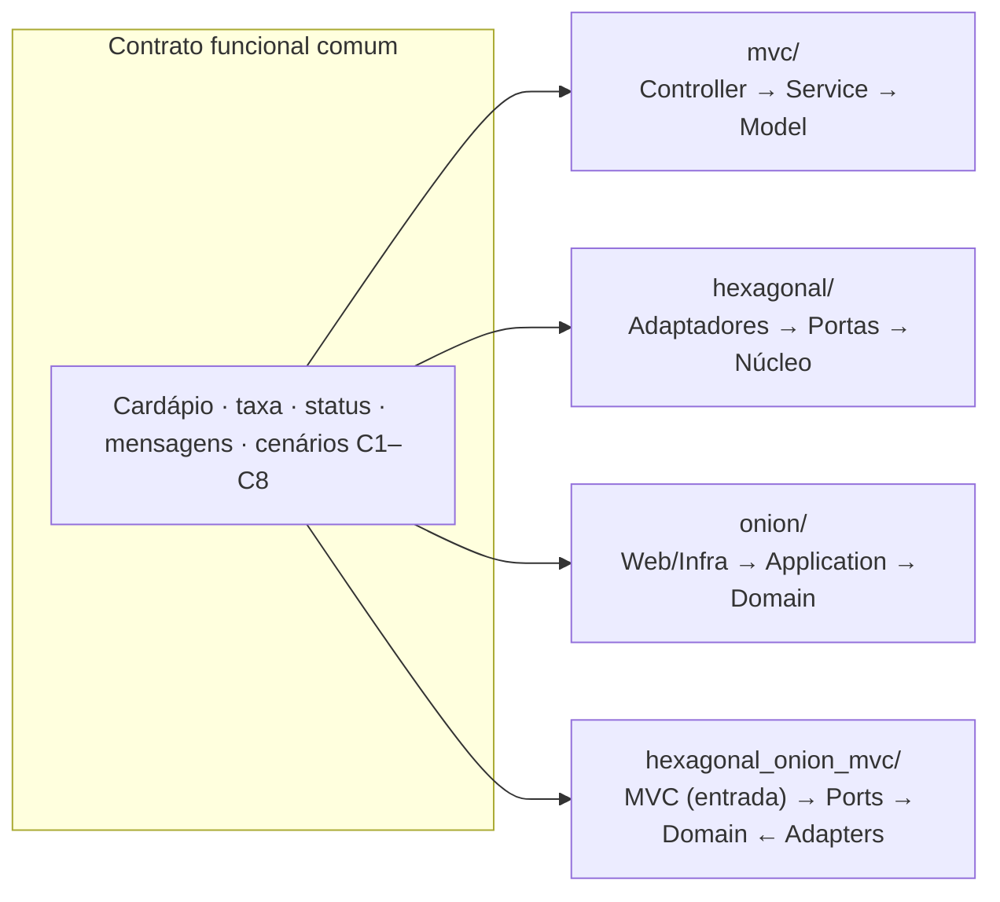

# PizzariaByte — Arquiteturas de Software em .NET 10

Quatro projetos **independentes, executáveis e testáveis** implementam o **mesmo caso de uso**, "realizar pedido de pizza", da pizzaria fictícia **PizzariaByte**. Cada um segue uma arquitetura diferente. Como as regras, os dados e os resultados são idênticos, dá para comparar lado a lado **onde cada responsabilidade mora** e **para onde apontam as dependências**.

| Diretório | Arquitetura | Interface web | Porta | Solução |
|-----------|-------------|---------------|-------|---------|
| [`mvc/`](mvc/README.md) | MVC (Model-View-Controller) | ASP.NET Core MVC | 5101 | `PizzariaByte.Mvc.sln` |
| [`hexagonal/`](hexagonal/README.md) | Hexagonal (Ports & Adapters) | Razor Pages | 5102 | `PizzariaByte.Hexagonal.sln` |
| [`onion/`](onion/README.md) | Onion Architecture | Razor Pages | 5103 | `PizzariaByte.Onion.sln` |
| [`hexagonal_onion_mvc/`](hexagonal_onion_mvc/README.md) | Hexagonal + Onion + MVC | ASP.NET Core MVC | 5104 | `PizzariaByte.Combined.sln` |

> Hexagonal e Onion usam **Razor Pages** de propósito, para que a tecnologia da tela não seja confundida com o padrão MVC dos projetos 1 e 4. As duas tecnologias usam arquivos Razor (`.cshtml`).

## Contrato funcional comum

Todos os projetos respeitam exatamente estas regras. Uma divergência entre eles é considerada defeito.

**Cardápio inicial** (recriado a cada inicialização):

| Id | Pizza | Ingredientes | Preço |
|----|-------|--------------|-------|
| 1 | Margherita | Molho de tomate, muçarela e manjericão | R$ 45,00 |
| 2 | Calabresa | Molho de tomate, muçarela, calabresa e cebola | R$ 50,00 |
| 3 | Quatro Queijos | Muçarela, provolone, parmesão e gorgonzola | R$ 55,00 |

**Regras:**

- Uma pizza por pedido, com **quantidade de 1 a 50**.
- **Endereço** obrigatório, com no máximo 200 caracteres (espaços nas pontas são ignorados).
- A pizza precisa existir no cardápio.
- **Subtotal** = preço × quantidade.
- **Taxa de entrega** = R$ 8,00. **Grátis quando o subtotal for maior ou igual a R$ 100,00.**
- **Total** = subtotal + taxa (sempre em `decimal`).
- O pedido recebe um `Guid` e o status inicial **Recebido**.
- A ordem dos efeitos é: validar → criar → **salvar** → e-mail (`ApiEmail`) → entrega (`ApiDeliveryAiQFome`) → definir o status → atualizar.
- O status final é **Confirmado** se a entrega foi solicitada, ou **Entrega pendente** se a `ApiDeliveryAiQFome` falhou. A falha do e-mail não muda o status, só aparece no resumo.
- `ApiMObservabilidade` registra `PedidoRejeitado`, `PedidoCriado`, `PedidoPersistido`, `FalhaIntegracao` e `PedidoFinalizado`. Se ela própria falhar, o pedido não é afetado.
- Pedido rejeitado **nunca** é salvo e **nunca** dispara integrações.

**Por que essa política de falhas?** Um pedido válido é sempre salvo antes de qualquer integração. Se o e-mail ou a entrega falharem, o pedido continua salvo e coerente (o status mostra a entrega pendente) e o resumo informa o que falhou. Nunca existe pedido notificado sem estar salvo, nem pedido "confirmado" sem entrega solicitada.

**Mensagens** (iguais nos quatro projetos):

| Situação | Mensagem |
|----------|----------|
| Quantidade ≤ 0 | A quantidade deve ser maior que zero. |
| Quantidade > 50 | A quantidade máxima por pedido é 50. |
| Endereço vazio | Informe o endereço de entrega. |
| Endereço > 200 | O endereço deve ter no máximo 200 caracteres. |
| Pizza inexistente | A pizza selecionada não existe no cardápio. |
| Sucesso | Pedido realizado com sucesso! |
| Sucesso com falha de integração | Pedido registrado, mas houve falha em uma ou mais integrações. Veja os detalhes abaixo. |
| Resumo inexistente | Pedido não encontrado. Lembre-se: os dados ficam em memória e são perdidos quando a aplicação é reiniciada. |

Na tela, a validação do formulário pode mostrar uma mensagem equivalente antes de chegar ao domínio (ex.: "A quantidade deve estar entre 1 e 50."). As mensagens acima são as do domínio e são verificadas pelos testes.

**Cenários de referência** (usados nos testes e nas aulas):

| # | Entrada | Resultado esperado |
|---|---------|--------------------|
| C1 | Margherita × 2, "Rua das Flores, 123" | Subtotal 90,00 · taxa 8,00 · **total 98,00** · Confirmado |
| C2 | Calabresa × 2 | Subtotal 100,00 · **taxa 0,00** · total 100,00 · Confirmado |
| C3 | Quatro Queijos × 1 | Subtotal 55,00 · taxa 8,00 · total 63,00 · Confirmado |
| C4 | Margherita × 0 (ou −1) | Rejeitado, não salvo |
| C5 | Pizza 99 | Rejeitado, não salvo |
| C6 | Endereço "   " | Rejeitado, não salvo |
| C7 | C1 com falha no e-mail | Total 98,00 · Confirmado · ApiEmail ❌ · salvo |
| C8 | C1 com falha na entrega | Total 98,00 · **Entrega pendente** · ApiDeliveryAiQFome ❌ · salvo |

As falhas de C7 e C8 são simuladas pela configuração `Integracoes:ApiEmail:SimularFalha` e `Integracoes:ApiDeliveryAiQFome:SimularFalha` (no `appsettings.json` de cada aplicação ou por variável de ambiente).

## Convenção de nomes

- **Conceitos de negócio em português**: `Pedido`, `Pizza`, `TaxaEntrega`, `EnderecoEntrega`, `CriarAsync`.
- **Papéis técnicos com sufixo em inglês**: `Repository`, `Gateway`, `Service`, `UseCase`, `Adapter`, `Controller`, `ViewModel`. Seguem o vocabulário usado na literatura e no próprio ASP.NET Core.
- Os nomes dos conectores são preservados: `ApiEmail`, `ApiDeliveryAiQFome` e `ApiMObservabilidade`.

## Comparação: onde fica cada coisa?

| Responsabilidade | MVC | Hexagonal | Onion | Combinado |
|------------------|-----|-----------|-------|-----------|
| Regras do pedido (`Pedido`, `TaxaEntrega`) | `Models/` | `Core/Dominio` | `Domain` (centro) | `Domain` (centro) |
| Caso de uso (criar pedido) | `Services/CriarPedidoService` | `Core/Aplicacao/CriarPedidoService` | `Application/Pedidos/CriarPedidoService` | `Application/UseCases/CriarPedidoUseCase` |
| Contrato de entrada do caso de uso | — (classe concreta) | **Porta de entrada** `ICriarPedidoUseCase` | — (classe concreta) | **Porta de entrada** `ICriarPedidoUseCase` |
| Interfaces de repositório | `Data/` | **Porta de saída** (`Core/Portas/Saida`) | **Domain** (`Repositorios/`) | **Porta de saída** (`Application/Ports/Saida`) |
| Interfaces dos conectores | `Integrations/` | **Porta de saída** (`Core/Portas/Saida`) | **Application** (`Interfaces/`) | **Porta de saída** (`Application/Ports/Saida`) |
| Implementações (memória + mocks) | `Data/`, `Integrations/` (mesmo projeto) | `Adapters.Persistencia`, `Adapters.Integracoes` | `Infrastructure` | `Adapters.Outbound` |
| Interface web | Controllers + Views | Razor Pages (**adaptador de entrada**) | Razor Pages (anel externo) | Controllers + ViewModels + Views (**adaptador de entrada**) |
| Composição da DI | `Program.cs` | `Adapters.Web/Program.cs` | `Web/Program.cs` | `Web/Program.cs` |
| Projetos `.csproj` (sem os testes) | 1 | 4 | 4 | 4 |
| Quem garante a direção das dependências | Disciplina (pastas) | Compilador (referências) | Compilador (referências) | Compilador (referências) |

## Quando usar cada arquitetura?

- **MVC**: aplicações web pequenas e médias, CRUDs e times iniciantes. É simples e direto, mas nada impede que o Controller ou a View comecem a acessar a persistência diretamente.
- **Hexagonal**: quando o sistema conversa com **muitos sistemas externos** (pagamentos, mensageria, APIs de parceiros) ou precisa de **várias formas de entrada** (web, API, filas, CLI). Também quando trocar tecnologias ou testar o núcleo isoladamente é importante.
- **Onion**: quando o **domínio é rico** e precisa ser protegido de detalhes técnicos por muito tempo. Os anéis deixam claro o que é regra, o que é aplicação e o que é infraestrutura.
- **Combinado**: sistemas de médio e grande porte com interface web. A Onion organiza os projetos, a Hexagonal formaliza a comunicação com o mundo externo e o MVC organiza as telas. Custa mais projetos e mais conceitos, por isso não vale a pena em sistemas pequenos.

## Sequência recomendada para a aula

1. **MVC**: comece pelo que os alunos já reconhecem. Mostre o fluxo Controller → Service → Model → View e a injeção de dependência.
2. **Onion**: traga as mesmas classes para dentro de anéis. Discuta a **direção das dependências** e por que o repositório fica no Domain e os gateways na Application.
3. **Hexagonal**: mude o ponto de vista de "camadas" para "dentro × fora". Introduza **portas de entrada e de saída** e mostre que os testes são "só mais um adaptador".
4. **Combinado**: junte tudo. Mostre que cada abordagem responde uma pergunta diferente e que, juntas, não criam camadas duplicadas.

Sugestão de exercício: em qualquer projeto, implemente um novo adaptador de e-mail (ex.: `EmailEmArquivoGateway`) e troque apenas o registro no `Program.cs`. Os testes devem continuar passando sem alteração.

## Pré-requisitos

- [.NET SDK 10](https://dotnet.microsoft.com/download) (10.0.100 ou superior). Cada projeto tem um `global.json`.
- Internet apenas no primeiro `dotnet restore` (pacotes do xUnit). As aplicações **não** acessam a internet: os três conectores são simulados.
- Nenhum banco de dados, Docker ou serviço externo.

## Comandos gerais

Cada diretório é independente: entre nele e use `dotnet restore`, `dotnet build`, `dotnet test` e `dotnet run --project src/<ProjetoWeb>` (detalhes em cada README).

Rodar os testes dos quatro projetos de uma vez:

```bash
# Linux / macOS (bash/zsh)
for d in mvc hexagonal onion hexagonal_onion_mvc; do (cd "$d" && dotnet test) || break; done
```

```powershell
# Windows (PowerShell)
foreach ($d in "mvc","hexagonal","onion","hexagonal_onion_mvc") { Push-Location $d; dotnet test; Pop-Location }
```

Os quatro podem rodar **ao mesmo tempo** (portas 5101 a 5104), cada um em um terminal. Encerre cada um com **Ctrl+C**.

Os dados ficam **em memória**: ao reiniciar uma aplicação, todos os pedidos são perdidos e o cardápio é recriado igual.

## Depuração

Abrindo a **raiz** no VS Code, o painel *Run and Debug* oferece uma configuração para cada projeto ("PizzariaByte MVC (5101)", "PizzariaByte Hexagonal (5102)", "PizzariaByte Onion (5103)" e "PizzariaByte Combinado (5104)"). Cada diretório também tem seu próprio `.vscode/` para ser aberto isoladamente. Os breakpoints sugeridos estão na seção 11 de cada README.

## Visão geral



## Estrutura do repositório

```text
.
├── README.md                 este arquivo
├── .vscode/                  depuração dos quatro projetos a partir da raiz
├── mvc/                      Projeto 1 — MVC
├── hexagonal/                Projeto 2 — Hexagonal
├── onion/                    Projeto 3 — Onion
├── hexagonal_onion_mvc/      Projeto 4 — Hexagonal + Onion + MVC
├── prompt.md                 requisito original
└── spdd/                     análise e especificação (REASONS Canvas) usadas para gerar o código
```
