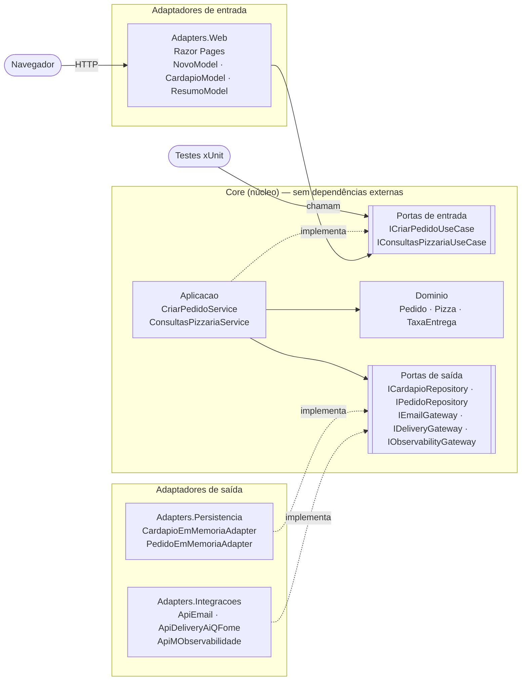
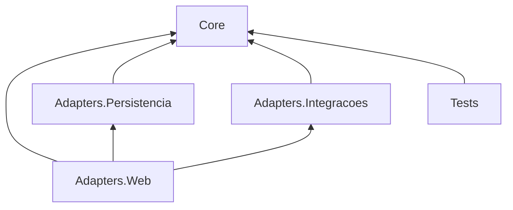
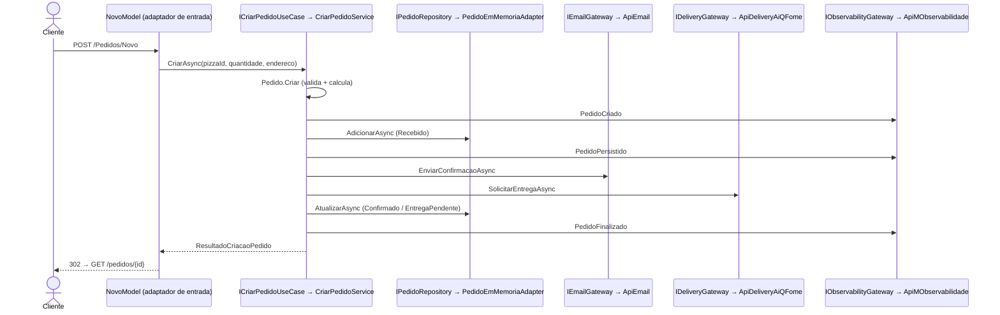

# PizzariaByte — Arquitetura Hexagonal (Ports & Adapters)

## 1. Objetivo

Mostrar como a **Arquitetura Hexagonal** isola o núcleo da aplicação, com suas regras e casos de uso, de todas as tecnologias externas: web, persistência, e-mail, entrega e observabilidade. O núcleo se comunica com o mundo **apenas por portas** (interfaces), e cada tecnologia entra como um **adaptador**.

O caso de uso e as regras são exatamente os mesmos dos outros três projetos (veja o [README da raiz](../README.md)).

## 2. Arquitetura demonstrada

```text
            Adaptador de ENTRADA                      Adaptadores de SAÍDA
         (quem chama o núcleo)                    (quem o núcleo chama)
   ┌──────────────────────────┐   ┌─────────┐   ┌────────────────────────────┐
   │ Adapters.Web (Razor Pages)│──▶│  CORE   │──▶│ Adapters.Persistencia      │
   │ testes xUnit (fakes)      │   │ portas  │   │ Adapters.Integracoes       │
   └──────────────────────────┘   └─────────┘   └────────────────────────────┘
```

- **Portas de entrada** (`Core/Portas/Entrada`): `ICriarPedidoUseCase` e `IConsultasPizzariaUseCase`. Definem o que o núcleo **oferece**.
- **Portas de saída** (`Core/Portas/Saida`): `ICardapioRepository`, `IPedidoRepository`, `IEmailGateway`, `IDeliveryGateway` e `IObservabilityGateway`. Definem o que o núcleo **precisa**.
- **Adaptadores de entrada**: as páginas Razor de `Adapters.Web` (e, nos testes, o próprio teste).
- **Adaptadores de saída**: `CardapioEmMemoriaAdapter`, `PedidoEmMemoriaAdapter`, `ApiEmail`, `ApiDeliveryAiQFome` e `ApiMObservabilidade`.

Não há "camadas" obrigatórias aqui: o que importa é a fronteira entre **dentro** (Core) e **fora** (adaptadores).

## 3. Conceitos fundamentais

- **O núcleo não referencia nada.** `PizzariaByte.Hexagonal.Core.csproj` não tem nenhuma `ProjectReference` nem `PackageReference`. O compilador garante que o domínio não conhece ASP.NET, banco ou conectores.
- **O núcleo define as portas**, e quem está fora as implementa. A dependência sempre aponta para o Core.
- **Trocar um adaptador não muda o núcleo**: os testes trocam todos os adaptadores de saída por fakes sem alterar uma linha do `CriarPedidoService`.
- **A raiz de composição** (`Program.cs` em `Adapters.Web`) é o único lugar que conhece porta e adaptador ao mesmo tempo.
- **A interface web é só mais um adaptador.** Poderíamos adicionar uma API REST ou uma CLI usando as mesmas portas de entrada.
- **Razor Pages** é usado como tecnologia da UI para não confundir com o padrão MVC dos projetos 1 e 4. É uma escolha de tecnologia, não de arquitetura.

## 4. Estrutura de diretórios

```text
hexagonal/
├── PizzariaByte.Hexagonal.sln
├── global.json
├── .vscode/
├── src/
│   ├── PizzariaByte.Hexagonal.Core/                  NÚCLEO (sem referências)
│   │   ├── Dominio/        Pizza, Pedido, StatusPedido, TaxaEntrega, ResultadoIntegracao, PedidoInvalidoException
│   │   ├── Portas/Entrada/ ICriarPedidoUseCase, IConsultasPizzariaUseCase, ResultadoCriacaoPedido
│   │   ├── Portas/Saida/   ICardapioRepository, IPedidoRepository, IEmailGateway, IDeliveryGateway,
│   │   │                   IObservabilityGateway, IntegracaoException
│   │   └── Aplicacao/      CriarPedidoService, ConsultasPizzariaService (implementam as portas de entrada)
│   ├── PizzariaByte.Hexagonal.Adapters.Persistencia/ → Core   CardapioEmMemoriaAdapter, PedidoEmMemoriaAdapter
│   ├── PizzariaByte.Hexagonal.Adapters.Integracoes/  → Core   ApiEmail, ApiDeliveryAiQFome, ApiMObservabilidade, ConfiguracaoMock
│   └── PizzariaByte.Hexagonal.Adapters.Web/          → Core, Persistencia, Integracoes
│       ├── Program.cs     raiz de composição (porta → adaptador)
│       ├── Pages/         Index, Cardapio, Pedidos/Novo, Pedidos/Resumo, Erro
│       └── wwwroot/css/site.css
└── tests/PizzariaByte.Hexagonal.Tests/               → Core apenas (fakes = adaptadores de teste)
```

## 5. Fluxo de execução do caso de uso

1. `GET /Cardapio`: `CardapioModel.OnGetAsync` chama a porta `IConsultasPizzariaUseCase.ListarCardapioAsync`.
2. `GET /Pedidos/Novo?pizzaId=1`: `NovoModel.OnGetAsync` monta o formulário.
3. `POST /Pedidos/Novo`: `NovoModel.OnPostAsync` valida o `ModelState` e chama a porta **`ICriarPedidoUseCase.CriarAsync`**.
4. No núcleo, `CriarPedidoService.CriarAsync`:
   1. porta `ICardapioRepository`, implementada por `CardapioEmMemoriaAdapter` (a pizza existe?);
   2. `Pedido.Criar` + `TaxaEntrega.Calcular`, com o status `Recebido`;
   3. porta `IPedidoRepository.AdicionarAsync`, implementada por `PedidoEmMemoriaAdapter`;
   4. porta `IEmailGateway`, implementada por `ApiEmail`;
   5. porta `IDeliveryGateway`, implementada por `ApiDeliveryAiQFome`;
   6. `Confirmado` ou `EntregaPendente`, seguido de `IPedidoRepository.AtualizarAsync`;
   7. porta `IObservabilityGateway`, implementada por `ApiMObservabilidade`, em cada marco.
5. A página redireciona (PRG) para `GET /pedidos/{id}`, e `ResumoModel` consulta `IConsultasPizzariaUseCase.ObterPedidoAsync`.

## 6. Diagramas



Dependências entre projetos (as setas apontam para quem é referenciado):





## 7. Tecnologias e dependências

- C# / .NET 10 (`net10.0`), ASP.NET Core **Razor Pages** (apenas no adaptador web).
- Injeção de dependência nativa do .NET.
- **Nenhum pacote NuGet nos projetos da aplicação.** O Core e os adaptadores de saída são `classlib` puras.
- Testes: os pacotes do template `dotnet new xunit` (`xunit`, `xunit.runner.visualstudio`, `Microsoft.NET.Test.Sdk` e `coverlet.collector`), necessários para escrever e executar testes xUnit. Sem bibliotecas de mock.

## 8. Pré-requisitos

- .NET SDK 10 (10.0.100 ou superior; veja `global.json`), conferido com `dotnet --list-sdks`.
- Opcional: VS Code + C# Dev Kit, Visual Studio (versão com suporte a .NET 10) ou Rider.
- Internet apenas no primeiro `dotnet restore` (pacotes de teste).

## 9. Restaurar, compilar, executar e testar

Dentro da pasta `hexagonal/`:

```bash
dotnet restore
dotnet build
dotnet test
dotnet run --project src/PizzariaByte.Hexagonal.Adapters.Web
```

Acesse **http://localhost:5102**. Para encerrar, pressione **Ctrl+C**.

## 10. Windows, Linux e macOS

| Passo | Windows (PowerShell) | Linux / macOS (bash/zsh) |
|-------|----------------------|--------------------------|
| Entrar na pasta | `cd hexagonal` | `cd hexagonal` |
| Executar | `dotnet run --project src\PizzariaByte.Hexagonal.Adapters.Web` | `dotnet run --project src/PizzariaByte.Hexagonal.Adapters.Web` |
| Testar | `dotnet test` | `dotnet test` |
| Simular falha da entrega | `$env:Integracoes__ApiDeliveryAiQFome__SimularFalha="true"; dotnet run --project src\PizzariaByte.Hexagonal.Adapters.Web` | `Integracoes__ApiDeliveryAiQFome__SimularFalha=true dotnet run --project src/PizzariaByte.Hexagonal.Adapters.Web` |
| Encerrar | `Ctrl+C` | `Ctrl+C` |

Só HTTP em desenvolvimento, então não é preciso configurar certificado. A cultura é fixa em pt-BR ("R$ 98,00") em qualquer sistema.

## 11. Depuração passo a passo

**VS Code**: abra `hexagonal/` (ou a raiz do repositório), vá em *Run and Debug*, escolha **"PizzariaByte Hexagonal (5102)"** e aperte **F5**.
**Visual Studio / Rider**: abra `PizzariaByte.Hexagonal.sln`, defina `PizzariaByte.Hexagonal.Adapters.Web` como projeto de inicialização (perfil `http`) e inicie a depuração.

**Breakpoints sugeridos (observe a travessia de fora para dentro e de volta para fora):**

1. `Adapters.Web/Pages/Pedidos/Novo.cshtml.cs`: `OnPostAsync` (adaptador de entrada).
2. `Core/Aplicacao/CriarPedidoService.cs`: `CriarAsync` (dentro do núcleo).
3. `Core/Dominio/Pedido.cs`: `Criar`.
4. `Core/Dominio/TaxaEntrega.cs`: `Calcular`.
5. `Adapters.Persistencia/PedidoEmMemoriaAdapter.cs`: `AdicionarAsync` (adaptador de saída).
6. `Adapters.Integracoes/ApiEmail.cs`: `EnviarConfirmacaoAsync`.
7. `Adapters.Integracoes/ApiDeliveryAiQFome.cs`: `SolicitarEntregaAsync`.
8. `Adapters.Persistencia/PedidoEmMemoriaAdapter.cs`: `AtualizarAsync`.

Na janela *Call Stack*, repare que o núcleo nunca aparece chamando uma classe concreta, só interfaces.

**Entradas de exemplo**: C1 Margherita × 2, "Rua das Flores, 123", total **R$ 98,00**, Confirmado. C2 Calabresa × 2, taxa **R$ 0,00**. C4 quantidade 0, erro. C7 `ApiEmail:SimularFalha=true`, Confirmado com e-mail ❌. C8 `ApiDeliveryAiQFome:SimularFalha=true`, **Entrega pendente**. As falhas se configuram na seção `Integracoes` de `appsettings.json` ou por variável de ambiente (tabela acima).

## 12. Como trocar um adaptador

1. Crie um novo adaptador que implemente a **porta de saída**, por exemplo `SmtpEmailAdapter : IEmailGateway`, em `Adapters.Integracoes` ou em um novo projeto `Adapters.Smtp`.
2. Em `Adapters.Web/Program.cs`, troque o registro:

```csharp
// antes
builder.Services.AddScoped<IEmailGateway>(_ => new ApiEmail(new ConfiguracaoMock(falhaEmail)));
// depois
builder.Services.AddScoped<IEmailGateway, SmtpEmailAdapter>();
```

Nada muda em `PizzariaByte.Hexagonal.Core`: nem o domínio, nem o caso de uso, nem as portas. A prova está nos testes, que passam `FakeEmailGateway`, `FakeDeliveryGateway` e outros fakes para as mesmas portas.

## 13. Limitações e simplificações didáticas

- Dados **em memória**: perdidos ao reiniciar ("Pedido não encontrado" ao abrir um resumo antigo).
- O projeto Web acumula dois papéis: adaptador de entrada e raiz de composição. Em sistemas maiores, o host costuma ficar em um projeto separado.
- Conectores simulados, sem rede. Sem retry nem outbox.
- Uma pizza por pedido, sem autenticação e sem listagem de pedidos.
- Apenas HTTP e validação somente no servidor.
