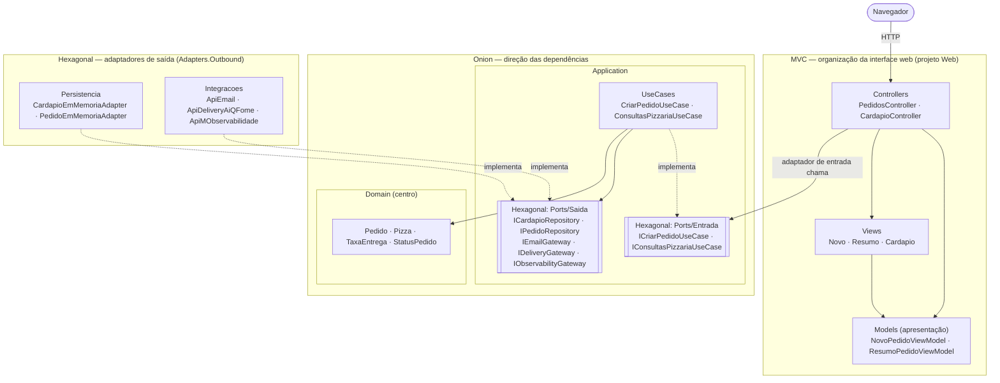
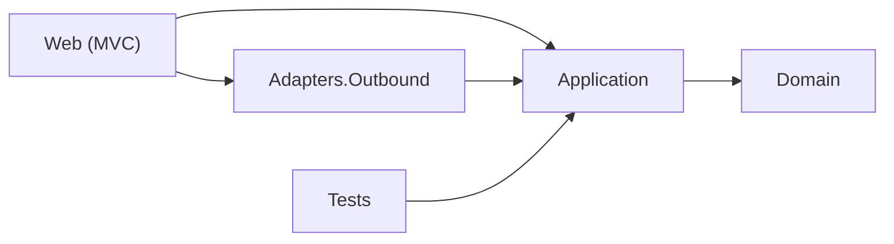
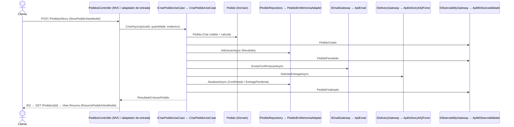

# PizzariaByte — Hexagonal + Onion + MVC (projeto combinado)

## 1. Objetivo

Mostrar que as três abordagens **não competem**: cada uma resolve um problema diferente e pode coexistir sem duplicar responsabilidades.

| Abordagem | Pergunta que responde | Onde aparece aqui |
|-----------|-----------------------|-------------------|
| **Onion** | Como organizar os projetos e para onde apontam as dependências? | `Domain` ← `Application` ← `Adapters.Outbound` / `Web` |
| **Hexagonal** | Como o núcleo conversa com o mundo externo? | `Application/Ports/Entrada`, `Application/Ports/Saida` e `Adapters.Outbound` |
| **MVC** | Como organizar a interface web? | `Web`: Controllers, Models (de apresentação) e Views |

O caso de uso e as regras são os mesmos dos outros três projetos (veja o [README da raiz](../README.md)).

## 2. Arquitetura demonstrada

```text
 ┌──────────────────────── Web (MVC) = adaptador de ENTRADA ─────────────────────────┐
 │ Controllers → Ports/Entrada      Models (ViewModels)      Views (.cshtml)         │
 └───────────────────────────────────────┬───────────────────────────────────────────┘
                                         ▼
 ┌──────────────────────────── Application (anel Onion) ─────────────────────────────┐
 │ Ports/Entrada (ICriarPedidoUseCase...)  UseCases (CriarPedidoUseCase...)          │
 │ Ports/Saida (IPedidoRepository, IEmailGateway, ...)                               │
 └───────────────────────────────────────┬───────────────────────────────────────────┘
                                         ▼
 ┌───────────────────────────── Domain (centro Onion) ───────────────────────────────┐
 │ Pedido · Pizza · StatusPedido · TaxaEntrega · ResultadoIntegracao                 │
 └───────────────────────────────────────────────────────────────────────────────────┘
       ▲ implementa Ports/Saida
 ┌─────┴──── Adapters.Outbound = adaptadores de SAÍDA ────┐
 │ Persistencia/ (memória)   Integracoes/ (ApiEmail...)    │
 └─────────────────────────────────────────────────────────┘
```

## 3. Conceitos fundamentais

- **Sem camadas duplicadas**: não existe projeto "Infrastructure" separado de `Adapters.Outbound`, nem "Contracts" ou "Shared". As portas de saída vivem na Application (Onion), que é quem precisa delas, e os adaptadores de saída cumprem o papel da Infrastructure.
- **O Controller MVC é o adaptador de entrada**: ele injeta só as **portas de entrada** (`ICriarPedidoUseCase` e `IConsultasPizzariaUseCase`) e nunca conhece repositórios ou conectores.
- **Os Models do MVC aqui são de apresentação**: no MVC puro, o "Model" é o domínio. Neste projeto o domínio vive no centro da Onion, então a camada web usa `NovoPedidoViewModel` e `ResumoPedidoViewModel`. O `ResumoPedidoViewModel.De(pedido)` apenas copia e formata dados e não repete nenhuma regra.
- **O domínio é puro**: `PizzariaByte.Combined.Domain.csproj` não referencia nada. Não conhece Controllers, Views, ASP.NET Core, EF Core nem adaptadores.
- **Raiz de composição única** (`Web/Program.cs`): é o único lugar onde porta e adaptador se encontram. Os comentários marcam as três perspectivas.

## 4. Estrutura de diretórios

```text
hexagonal_onion_mvc/
├── PizzariaByte.Combined.sln
├── global.json
├── .vscode/
├── src/
│   ├── PizzariaByte.Combined.Domain/              Onion: centro (sem referências)
│   │   └── Pizza, Pedido, StatusPedido, ResultadoIntegracao, TaxaEntrega, PedidoInvalidoException
│   ├── PizzariaByte.Combined.Application/         Onion: aplicação → Domain
│   │   ├── Ports/Entrada/  ICriarPedidoUseCase, IConsultasPizzariaUseCase, ResultadoCriacaoPedido   (Hexagonal)
│   │   ├── Ports/Saida/    ICardapioRepository, IPedidoRepository, IEmailGateway, IDeliveryGateway,
│   │   │                   IObservabilityGateway, IntegracaoException                              (Hexagonal)
│   │   └── UseCases/       CriarPedidoUseCase, ConsultasPizzariaUseCase
│   ├── PizzariaByte.Combined.Adapters.Outbound/   Hexagonal: adaptadores de saída → Application
│   │   ├── Persistencia/   CardapioEmMemoriaAdapter, PedidoEmMemoriaAdapter
│   │   └── Integracoes/    ApiEmail, ApiDeliveryAiQFome, ApiMObservabilidade, ConfiguracaoMock
│   └── PizzariaByte.Combined.Web/                 MVC + adaptador de entrada → Application, Adapters.Outbound
│       ├── Program.cs
│       ├── Controllers/    Home, Cardapio, Pedidos, Erro
│       ├── Models/         NovoPedidoViewModel, ResumoPedidoViewModel
│       ├── Views/          _Layout, Home, Cardapio, Pedidos (Novo, Resumo, NaoEncontrado), Erro
│       └── wwwroot/css/site.css
└── tests/PizzariaByte.Combined.Tests/             → Application (e Domain)
```

## 5. Fluxo de execução do caso de uso

1. `GET /Cardapio`: `CardapioController` (MVC) chama a porta de entrada `IConsultasPizzariaUseCase`, implementada por `ConsultasPizzariaUseCase`, que usa a porta de saída `ICardapioRepository`, implementada por `CardapioEmMemoriaAdapter`.
2. `GET /Pedidos/Novo?pizzaId=1`: `PedidosController.Novo` monta o `NovoPedidoViewModel`.
3. `POST /Pedidos/Novo`: o Controller valida o `ModelState` e chama a porta **`ICriarPedidoUseCase.CriarAsync`**.
4. `CriarPedidoUseCase` (Application):
   1. `ICardapioRepository`, implementado por `CardapioEmMemoriaAdapter`;
   2. `Pedido.Criar` + `TaxaEntrega.Calcular` (Domain), com o status `Recebido`;
   3. `IPedidoRepository.AdicionarAsync`, implementado por `PedidoEmMemoriaAdapter`;
   4. `IEmailGateway`, implementado por `ApiEmail`;
   5. `IDeliveryGateway`, implementado por `ApiDeliveryAiQFome`;
   6. `Confirmado` ou `EntregaPendente`, seguido de `AtualizarAsync`;
   7. `IObservabilityGateway`, implementado por `ApiMObservabilidade`.
5. PRG: `RedirectToAction(Resumo)` leva a `GET /Pedidos/{id}`. O Controller converte `Pedido` em `ResumoPedidoViewModel` e devolve a View `Resumo`.

## 6. Diagramas

Onde cada princípio se manifesta:



Dependências entre projetos (todas apontam para o centro):





## 7. Tecnologias e dependências

- C# / .NET 10 (`net10.0`), ASP.NET Core **MVC** com Razor Views (somente no projeto Web).
- Injeção de dependência nativa do .NET.
- **Nenhum pacote NuGet nos projetos da aplicação.**
- Testes: os pacotes do template `dotnet new xunit` (`xunit`, `xunit.runner.visualstudio`, `Microsoft.NET.Test.Sdk` e `coverlet.collector`). Sem bibliotecas de mock.

## 8. Pré-requisitos

- .NET SDK 10 (10.0.100 ou superior; veja `global.json`).
- Opcional: VS Code + C# Dev Kit, Visual Studio (versão com suporte a .NET 10) ou Rider.
- Internet apenas no primeiro `dotnet restore`.

## 9. Restaurar, compilar, executar e testar

Dentro da pasta `hexagonal_onion_mvc/`:

```bash
dotnet restore
dotnet build
dotnet test
dotnet run --project src/PizzariaByte.Combined.Web
```

Acesse **http://localhost:5104**. Para encerrar, pressione **Ctrl+C**.

## 10. Windows, Linux e macOS

| Passo | Windows (PowerShell) | Linux / macOS (bash/zsh) |
|-------|----------------------|--------------------------|
| Entrar na pasta | `cd hexagonal_onion_mvc` | `cd hexagonal_onion_mvc` |
| Executar | `dotnet run --project src\PizzariaByte.Combined.Web` | `dotnet run --project src/PizzariaByte.Combined.Web` |
| Testar | `dotnet test` | `dotnet test` |
| Simular falha da entrega | `$env:Integracoes__ApiDeliveryAiQFome__SimularFalha="true"; dotnet run --project src\PizzariaByte.Combined.Web` | `Integracoes__ApiDeliveryAiQFome__SimularFalha=true dotnet run --project src/PizzariaByte.Combined.Web` |
| Encerrar | `Ctrl+C` | `Ctrl+C` |

Só HTTP em desenvolvimento, sem certificado. Cultura fixa pt-BR.

## 11. Depuração passo a passo

**VS Code**: abra `hexagonal_onion_mvc/` (ou a raiz do repositório), vá em *Run and Debug*, escolha **"PizzariaByte Combinado (5104)"** e aperte **F5**.
**Visual Studio / Rider**: abra `PizzariaByte.Combined.sln`, defina `PizzariaByte.Combined.Web` como projeto de inicialização (perfil `http`) e depure.

**Breakpoints sugeridos:**

1. `Web/Controllers/PedidosController.cs`: `Novo(NovoPedidoViewModel)` POST (MVC / adaptador de entrada).
2. `Application/UseCases/CriarPedidoUseCase.cs`: `CriarAsync` (atrás da porta de entrada).
3. `Domain/Pedido.cs`: `Criar` (centro).
4. `Domain/TaxaEntrega.cs`: `Calcular`.
5. `Adapters.Outbound/Persistencia/PedidoEmMemoriaAdapter.cs`: `AdicionarAsync` (adaptador de saída).
6. `Adapters.Outbound/Integracoes/ApiEmail.cs`: `EnviarConfirmacaoAsync`.
7. `Adapters.Outbound/Integracoes/ApiDeliveryAiQFome.cs`: `SolicitarEntregaAsync`.
8. `Web/Models/ResumoPedidoViewModel.cs`: `De` (volta para a apresentação MVC).

**Entradas de exemplo**: C1 Margherita × 2, "Rua das Flores, 123", **R$ 98,00**, Confirmado. C2 Calabresa × 2, taxa **R$ 0,00**. C4 quantidade 0, erro. C7 e C8 com `Integracoes:<Conector>:SimularFalha=true` em `appsettings.json`: e-mail ❌ (Confirmado) e entrega ❌ (**Entrega pendente**).

## 12. Como trocar um adaptador

1. Crie um adaptador de saída em `Adapters.Outbound` (ou em um novo projeto), por exemplo `SmtpEmailAdapter : IEmailGateway`.
2. Em `Web/Program.cs`:

```csharp
// antes
builder.Services.AddScoped<IEmailGateway>(_ => new ApiEmail(new ConfiguracaoMock(falhaEmail)));
// depois
builder.Services.AddScoped<IEmailGateway, SmtpEmailAdapter>();
```

Domain, Application e os Controllers não mudam.

## 13. Limitações e simplificações didáticas

- Dados **em memória**: perdidos ao reiniciar.
- `NovoPedidoViewModel` expõe a lista de `Pizza` do domínio para montar o `<select>`, uma simplificação para não criar um terceiro ViewModel.
- O projeto Web é ao mesmo tempo adaptador de entrada e raiz de composição.
- Conectores simulados, sem rede. Sem retry nem outbox.
- Uma pizza por pedido, sem autenticação e sem listagem de pedidos.
- Apenas HTTP e validação somente no servidor.
