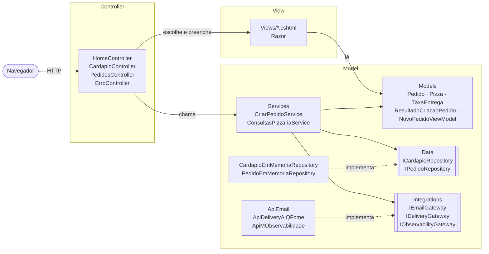
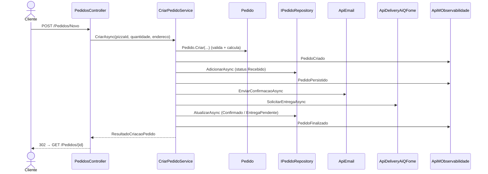

# PizzariaByte — MVC (Model-View-Controller)

## 1. Objetivo

Mostrar como uma aplicação web **ASP.NET Core MVC** organiza o caso de uso "realizar pedido de pizza" separando **Model**, **View** e **Controller**. As regras de negócio, a persistência e as integrações ficam fora do Controller.

Este é o primeiro dos quatro projetos do repositório. Todos implementam o **mesmo contrato funcional** (veja o [README da raiz](../README.md)), o que permite comparar as arquiteturas lado a lado.

## 2. Arquitetura demonstrada

MVC é um padrão de **organização da interface com o usuário**:

| Papel | Onde está neste projeto | Responsabilidade |
|-------|-------------------------|------------------|
| **Model** | `Models/`, `Services/`, `Data/`, `Integrations/` | Dados, regras de negócio, orquestração do caso de uso, persistência e conectores |
| **View** | `Views/` (Razor `.cshtml`) | Só apresentação: transforma o Model em HTML |
| **Controller** | `Controllers/` | Recebe a requisição, valida a entrada da tela, chama o Model e escolhe a View |

No MVC, "Model" não é só uma classe de dados. É **toda a parte da aplicação que não é tela**. Por isso `Services/`, `Data/` e `Integrations/` são subdivisões do Model, feitas por organização.

## 3. Conceitos fundamentais

- **Controller com responsabilidades limitadas**: o `PedidosController` não calcula nada nem salva nada. Ele delega ao `CriarPedidoService`.
- **Model rico**: `Pedido.Criar` valida quantidade e endereço e calcula subtotal, taxa e total.
- **View focada em apresentação**: as Views só exibem dados. Até o texto do status é decidido na apresentação, sem regra de negócio.
- **Post-Redirect-Get (PRG)**: depois do POST que cria o pedido, o Controller redireciona para `GET /Pedidos/{id}`. Apertar F5 no resumo não cria um pedido duplicado.
- **Injeção de dependência**: o `CriarPedidoService` recebe pelo construtor cinco **interfaces** (`ICardapioRepository`, `IPedidoRepository`, `IEmailGateway`, `IDeliveryGateway` e `IObservabilityGateway`) e não conhece as classes concretas.
- **Interfaces no MVC** existem aqui para permitir DI e testes. Ninguém as chama de "portas", e elas não definem a arquitetura. Compare com o projeto Hexagonal.

## 4. Estrutura de diretórios

```text
mvc/
├── PizzariaByte.Mvc.sln
├── global.json                      fixa o SDK .NET 10
├── .vscode/                         launch.json e tasks.json para depuração
├── src/PizzariaByte.Mvc/            ÚNICO projeto da aplicação (ASP.NET Core MVC)
│   ├── Program.cs                   registro da DI e pipeline HTTP
│   ├── appsettings.json             inclui a seção "Integracoes" (simular falhas)
│   ├── Properties/launchSettings.json  http://localhost:5101
│   ├── Controllers/                 Home, Cardapio, Pedidos, Erro
│   ├── Models/                      Pizza, Pedido, StatusPedido, TaxaEntrega, ResultadoIntegracao,
│   │                                PedidoInvalidoException, ResultadoCriacaoPedido, NovoPedidoViewModel
│   ├── Services/                    CriarPedidoService, ConsultasPizzariaService
│   ├── Data/                        ICardapioRepository, IPedidoRepository + implementações em memória
│   ├── Integrations/                IEmailGateway/ApiEmail, IDeliveryGateway/ApiDeliveryAiQFome,
│   │                                IObservabilityGateway/ApiMObservabilidade, IntegracaoException, ConfiguracaoMock
│   ├── Views/                       _Layout, Home, Cardapio, Pedidos (Novo, Resumo, NaoEncontrado), Erro
│   └── wwwroot/css/site.css
└── tests/PizzariaByte.Mvc.Tests/    xUnit + fakes escritos à mão
```

## 5. Fluxo de execução do caso de uso

1. `GET /Cardapio`: `CardapioController.Index` chama `ConsultasPizzariaService.ListarCardapioAsync` e a View lista as 3 pizzas.
2. O cliente clica em **Pedir**, o que leva a `GET /Pedidos/Novo?pizzaId=1`. `PedidosController.Novo` monta o `NovoPedidoViewModel`.
3. O cliente preenche a quantidade e o endereço e clica em **Confirmar pedido**, o que dispara `POST /Pedidos/Novo`.
4. `PedidosController.Novo(NovoPedidoViewModel)` verifica o `ModelState` (DataAnnotations).
5. O Controller chama `CriarPedidoService.CriarAsync(pizzaId, quantidade, endereco)`, que executa:
   1. `ICardapioRepository.ObterPorIdAsync` (a pizza existe?);
   2. `Pedido.Criar` (valida e calcula com `TaxaEntrega.Calcular`), com o status `Recebido`;
   3. `IPedidoRepository.AdicionarAsync` (salva em memória);
   4. `IEmailGateway.EnviarConfirmacaoAsync` (`ApiEmail`);
   5. `IDeliveryGateway.SolicitarEntregaAsync` (`ApiDeliveryAiQFome`);
   6. status `Confirmado` ou `EntregaPendente`, seguido de `IPedidoRepository.AtualizarAsync`;
   7. em cada etapa, `IObservabilityGateway.RegistrarEventoAsync` (`ApiMObservabilidade`).
6. Em caso de sucesso, o Controller faz `RedirectToAction(Resumo)`. Em caso de erro, devolve a mesma View com as mensagens.
7. `GET /Pedidos/{id}`: `PedidosController.Resumo` exibe o total e o status de cada integração.

## 6. Diagramas





## 7. Tecnologias e dependências

- C# / .NET 10 (`net10.0`) e ASP.NET Core MVC com Razor Views.
- Injeção de dependência nativa do .NET.
- HTML e CSS próprios, **sem** Bootstrap e sem jQuery.
- **Nenhum pacote NuGet no projeto da aplicação.**
- Projeto de testes: apenas os pacotes do template oficial `dotnet new xunit`:
  - `xunit`: o framework de testes exigido.
  - `xunit.runner.visualstudio`: permite rodar os testes com `dotnet test` e nas IDEs.
  - `Microsoft.NET.Test.Sdk`: infraestrutura de execução de testes do .NET.
  - `coverlet.collector`: coleta de cobertura (opcional, vem no template).
- Nenhuma biblioteca de mock: os fakes são classes simples em `tests/.../Fakes`.

## 8. Pré-requisitos

- [.NET SDK 10](https://dotnet.microsoft.com/download) (10.0.100 ou superior; veja `global.json`). Confira com `dotnet --list-sdks`.
- Opcional: VS Code com a extensão **C# Dev Kit**, Visual Studio (versão com suporte a .NET 10) ou JetBrains Rider.
- Acesso à internet **somente** no primeiro `dotnet restore` (download dos pacotes de teste). A aplicação em si não acessa a internet.

## 9. Restaurar, compilar, executar e testar

Todos os comandos são executados dentro da pasta `mvc/`:

```bash
dotnet restore
dotnet build
dotnet test
dotnet run --project src/PizzariaByte.Mvc
```

Acesse **http://localhost:5101** no navegador. Para encerrar, pressione **Ctrl+C** no terminal.

## 10. Windows, Linux e macOS

| Passo | Windows (PowerShell) | Linux / macOS (bash/zsh) |
|-------|----------------------|--------------------------|
| Entrar na pasta | `cd mvc` | `cd mvc` |
| Executar | `dotnet run --project src\PizzariaByte.Mvc` | `dotnet run --project src/PizzariaByte.Mvc` |
| Testar | `dotnet test` | `dotnet test` |
| Simular falha do e-mail | `$env:Integracoes__ApiEmail__SimularFalha="true"; dotnet run --project src\PizzariaByte.Mvc` | `Integracoes__ApiEmail__SimularFalha=true dotnet run --project src/PizzariaByte.Mvc` |
| Encerrar | `Ctrl+C` | `Ctrl+C` |

No PowerShell, a variável de ambiente continua definida na sessão. Remova-a com `Remove-Item Env:Integracoes__ApiEmail__SimularFalha`.

O projeto usa apenas HTTP em desenvolvimento, então não é preciso configurar certificado (`dotnet dev-certs`). A cultura é fixada em pt-BR no `Program.cs`, e os valores aparecem como "R$ 98,00" em qualquer sistema operacional.

## 11. Depuração passo a passo

**VS Code**: abra a pasta `mvc/` (ou a raiz do repositório, que tem uma configuração para cada projeto), vá em *Run and Debug* e escolha **"PizzariaByte MVC (5101)"**. Depois aperte **F5**. O `tasks.json` compila antes e o navegador abre sozinho.

**Visual Studio**: abra `PizzariaByte.Mvc.sln`, defina `PizzariaByte.Mvc` como projeto de inicialização, escolha o perfil `http` e aperte **F5**.

**Rider**: abra `PizzariaByte.Mvc.sln`, selecione a configuração `PizzariaByte.Mvc: http` e clique em *Debug*.

**Breakpoints sugeridos, na ordem do fluxo:**

1. `Controllers/PedidosController.cs`: primeira linha do `Novo(NovoPedidoViewModel modelo)` (POST).
2. `Services/CriarPedidoService.cs`: início de `CriarAsync`.
3. `Models/Pedido.cs`: início de `Criar`.
4. `Models/TaxaEntrega.cs`: `Calcular`.
5. `Data/PedidoEmMemoriaRepository.cs`: `AdicionarAsync`.
6. `Integrations/ApiEmail.cs`: `EnviarConfirmacaoAsync`.
7. `Integrations/ApiDeliveryAiQFome.cs`: `SolicitarEntregaAsync`.
8. `Data/PedidoEmMemoriaRepository.cs`: `AtualizarAsync`.

**Entradas para testar na tela:**

| Cenário | Pizza | Quantidade | Endereço | Resultado esperado |
|---------|-------|------------|----------|--------------------|
| C1 | Margherita | 2 | Rua das Flores, 123 | Total **R$ 98,00**, status Confirmado |
| C2 | Calabresa | 2 | Rua das Flores, 123 | Taxa **R$ 0,00**, total R$ 100,00 |
| C4 | Margherita | 0 | Rua A, 1 | Mensagem de erro, nada é salvo |
| C7 | Margherita | 2 | Rua A, 1 | Com `ApiEmail:SimularFalha=true`: Confirmado, e-mail ❌ |
| C8 | Margherita | 2 | Rua A, 1 | Com `ApiDeliveryAiQFome:SimularFalha=true`: **Entrega pendente**, entrega ❌ |

Para C7 e C8, altere `appsettings.json` (ou `appsettings.Development.json`) e reinicie:

```json
"Integracoes": {
  "ApiEmail": { "SimularFalha": true },
  "ApiDeliveryAiQFome": { "SimularFalha": false }
}
```

As linhas `[ApiEmail]`, `[ApiDeliveryAiQFome]` e `[ApiMObservabilidade]` aparecem no terminal e mostram o fluxo.

## 12. Como trocar uma integração mockada

1. Crie uma nova classe que implemente a mesma interface, por exemplo `Integrations/SmtpEmailGateway.cs : IEmailGateway`.
2. Em `Program.cs`, troque **uma linha**:

```csharp
// antes
builder.Services.AddScoped<IEmailGateway>(_ => new ApiEmail(new ConfiguracaoMock(falhaEmail)));
// depois
builder.Services.AddScoped<IEmailGateway, SmtpEmailGateway>();
```

O `CriarPedidoService` e o `PedidosController` não mudam, porque dependem apenas de `IEmailGateway`. Os testes fazem o mesmo ao passar `FakeEmailGateway` no lugar de `ApiEmail`.

## 13. Limitações e simplificações didáticas

- **Dados em memória**: os pedidos são perdidos quando a aplicação é reiniciada. Um resumo aberto depois de reiniciar mostra "Pedido não encontrado".
- Uma pizza por pedido, sem carrinho, sem autenticação e sem listagem de pedidos.
- Os conectores são **simulados**: escrevem no console e não fazem chamadas de rede.
- Não há retry, fila nem outbox para as integrações. A consistência vem da ordem dos passos (salvar, depois integrar, depois atualizar o status).
- Apenas HTTP em desenvolvimento.
- Validação somente no servidor (sem JavaScript).
