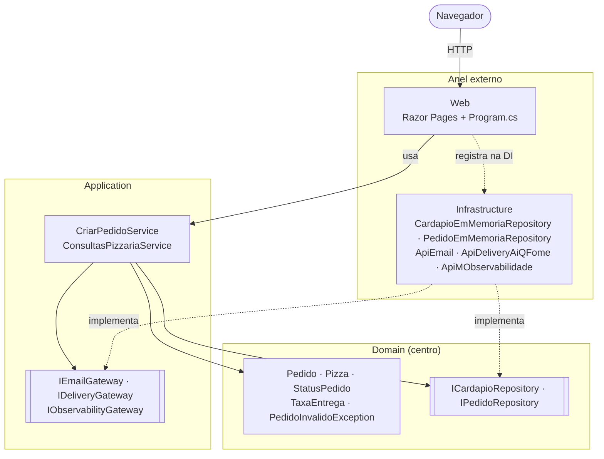
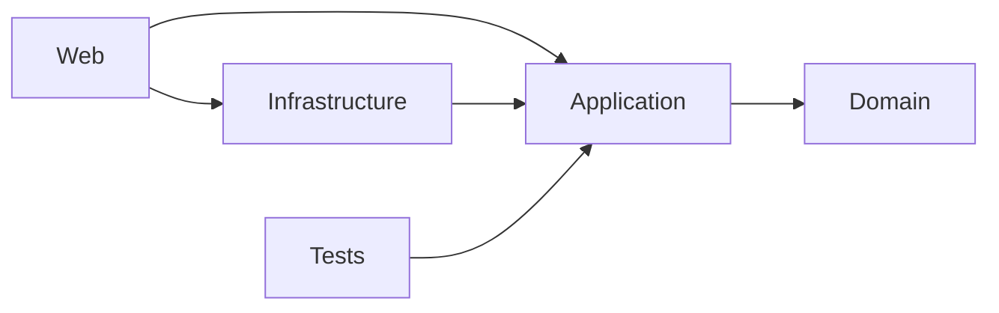
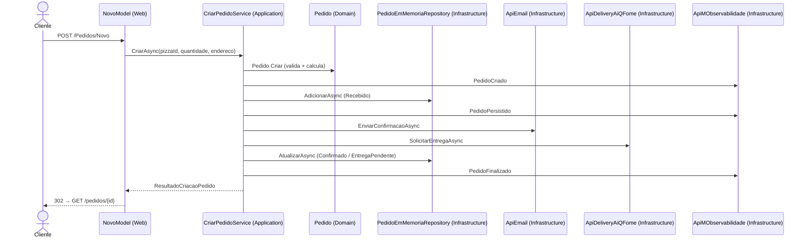

# PizzariaByte — Onion Architecture

## 1. Objetivo

Mostrar como a **Onion Architecture** coloca o **domínio no centro** e organiza o resto em anéis concêntricos, com **todas as dependências apontando para dentro**. As regras de negócio não sabem que existe web, memória, e-mail ou entrega.

O caso de uso e as regras são idênticos aos dos outros três projetos (veja o [README da raiz](../README.md)).

## 2. Arquitetura demonstrada

```text
        ┌───────────────────────────────────────────────┐
        │  Web (Razor Pages) · Infrastructure           │  ← anel externo
        │   ┌───────────────────────────────────────┐   │
        │   │  Application (casos de uso + contratos│   │
        │   │  de serviços externos)                │   │
        │   │   ┌───────────────────────────────┐   │   │
        │   │   │  Domain (entidades, regras,   │   │   │  ← centro
        │   │   │  contratos de repositório)    │   │   │
        │   │   └───────────────────────────────┘   │   │
        │   └───────────────────────────────────────┘   │
        └───────────────────────────────────────────────┘
```

| Anel | Projeto | Conteúdo | Referencia |
|------|---------|----------|------------|
| Centro | `PizzariaByte.Onion.Domain` | Entidades, `TaxaEntrega`, `PedidoInvalidoException`, `ICardapioRepository`, `IPedidoRepository` | nada |
| Aplicação | `PizzariaByte.Onion.Application` | `CriarPedidoService`, `ConsultasPizzariaService`, `ResultadoCriacaoPedido`, `IEmailGateway`, `IDeliveryGateway`, `IObservabilityGateway` | Domain |
| Externo | `PizzariaByte.Onion.Infrastructure` | Repositórios em memória e conectores `ApiEmail`, `ApiDeliveryAiQFome` e `ApiMObservabilidade` | Application (e Domain) |
| Externo | `PizzariaByte.Onion.Web` | Razor Pages e composição da DI | Application, Infrastructure |

## 3. Conceitos fundamentais

- **Dependências para dentro**: Domain não referencia ninguém, Application só conhece o Domain, e Infrastructure e Web ficam do lado de fora. As `ProjectReference` dos `.csproj` garantem isso na compilação.
- **Cada interface fica no anel de quem precisa dela**:
  - os **repositórios** (`ICardapioRepository` e `IPedidoRepository`) ficam no **Domain**, porque descrevem coleções de entidades do domínio;
  - os **serviços externos** (`IEmailGateway`, `IDeliveryGateway` e `IObservabilityGateway`) ficam na **Application**, porque são necessidades do caso de uso e não do domínio.
- **Infrastructure implementa**: as classes concretas de persistência e integração vivem no anel externo.
- **Interfaces não são proibidas, nem obrigatórias**: os serviços de aplicação (`CriarPedidoService` e `ConsultasPizzariaService`) são **classes concretas**, usadas diretamente pela Web. A regra da Onion é a **direção das dependências**, não "tudo precisa de interface". Compare com o Hexagonal, que define portas de entrada.
- **Web é o anel mais externo** e a raiz de composição: só ela conhece a Infrastructure, e apenas para registrar as implementações na DI.
- **Razor Pages** é usado como tecnologia de apresentação para não confundir com o padrão MVC dos projetos 1 e 4.

## 4. Estrutura de diretórios

```text
onion/
├── PizzariaByte.Onion.sln
├── global.json
├── .vscode/
├── src/
│   ├── PizzariaByte.Onion.Domain/
│   │   ├── Entidades/     Pizza, Pedido, StatusPedido, ResultadoIntegracao
│   │   ├── Servicos/      TaxaEntrega (regra de domínio)
│   │   ├── Excecoes/      PedidoInvalidoException
│   │   └── Repositorios/  ICardapioRepository, IPedidoRepository
│   ├── PizzariaByte.Onion.Application/
│   │   ├── Interfaces/    IEmailGateway, IDeliveryGateway, IObservabilityGateway, IntegracaoException
│   │   └── Pedidos/       CriarPedidoService, ConsultasPizzariaService, ResultadoCriacaoPedido
│   ├── PizzariaByte.Onion.Infrastructure/
│   │   ├── Persistencia/  CardapioEmMemoriaRepository, PedidoEmMemoriaRepository
│   │   └── Integracoes/   ApiEmail, ApiDeliveryAiQFome, ApiMObservabilidade, ConfiguracaoMock
│   └── PizzariaByte.Onion.Web/
│       ├── Program.cs     composição da DI
│       ├── Pages/         Index, Cardapio, Pedidos/Novo, Pedidos/Resumo, Erro
│       └── wwwroot/css/site.css
└── tests/PizzariaByte.Onion.Tests/   → Application (e Domain); nunca Infrastructure nem Web
```

## 5. Fluxo de execução do caso de uso

1. `GET /Cardapio` (Web): `CardapioModel` chama `ConsultasPizzariaService` (Application), que usa `ICardapioRepository` (Domain), implementado por `CardapioEmMemoriaRepository` (Infrastructure).
2. `GET /Pedidos/Novo?pizzaId=1`: `NovoModel.OnGetAsync`.
3. `POST /Pedidos/Novo`: `NovoModel.OnPostAsync` valida o `ModelState` e chama **`CriarPedidoService.CriarAsync`** (Application).
4. Na Application, o `CriarPedidoService`:
   1. consulta `ICardapioRepository` (contrato do Domain);
   2. cria o pedido com `Pedido.Criar` + `TaxaEntrega.Calcular` (Domain), com o status `Recebido`;
   3. salva com `IPedidoRepository.AdicionarAsync`, implementado por `PedidoEmMemoriaRepository` (Infrastructure);
   4. envia o e-mail por `IEmailGateway` (contrato da Application), implementado por `ApiEmail` (Infrastructure);
   5. solicita a entrega por `IDeliveryGateway`, implementado por `ApiDeliveryAiQFome`;
   6. define `Confirmado` ou `EntregaPendente` e chama `AtualizarAsync`;
   7. registra eventos em `IObservabilityGateway`, implementado por `ApiMObservabilidade`.
5. Redireciona (PRG) para `GET /pedidos/{id}`, e `ResumoModel` exibe o resultado.

## 6. Diagramas



Dependências entre projetos (todas apontam para o centro):





## 7. Tecnologias e dependências

- C# / .NET 10 (`net10.0`), ASP.NET Core **Razor Pages** (somente no projeto Web).
- Injeção de dependência nativa do .NET.
- **Nenhum pacote NuGet nos projetos da aplicação.** Domain, Application e Infrastructure são `classlib` puras.
- Testes: os pacotes do template `dotnet new xunit` (`xunit`, `xunit.runner.visualstudio`, `Microsoft.NET.Test.Sdk` e `coverlet.collector`). Sem bibliotecas de mock.

## 8. Pré-requisitos

- .NET SDK 10 (10.0.100 ou superior; veja `global.json`).
- Opcional: VS Code + C# Dev Kit, Visual Studio (versão com suporte a .NET 10) ou Rider.
- Internet apenas no primeiro `dotnet restore`.

## 9. Restaurar, compilar, executar e testar

Dentro da pasta `onion/`:

```bash
dotnet restore
dotnet build
dotnet test
dotnet run --project src/PizzariaByte.Onion.Web
```

Acesse **http://localhost:5103**. Para encerrar, pressione **Ctrl+C**.

## 10. Windows, Linux e macOS

| Passo | Windows (PowerShell) | Linux / macOS (bash/zsh) |
|-------|----------------------|--------------------------|
| Entrar na pasta | `cd onion` | `cd onion` |
| Executar | `dotnet run --project src\PizzariaByte.Onion.Web` | `dotnet run --project src/PizzariaByte.Onion.Web` |
| Testar | `dotnet test` | `dotnet test` |
| Simular falha do e-mail | `$env:Integracoes__ApiEmail__SimularFalha="true"; dotnet run --project src\PizzariaByte.Onion.Web` | `Integracoes__ApiEmail__SimularFalha=true dotnet run --project src/PizzariaByte.Onion.Web` |
| Encerrar | `Ctrl+C` | `Ctrl+C` |

Só HTTP em desenvolvimento, sem certificado. Cultura fixa pt-BR.

## 11. Depuração passo a passo

**VS Code**: abra `onion/` (ou a raiz do repositório), vá em *Run and Debug*, escolha **"PizzariaByte Onion (5103)"** e aperte **F5**.
**Visual Studio / Rider**: abra `PizzariaByte.Onion.sln`, defina `PizzariaByte.Onion.Web` como projeto de inicialização (perfil `http`) e depure.

**Breakpoints sugeridos (de fora para o centro e de volta):**

1. `Web/Pages/Pedidos/Novo.cshtml.cs`: `OnPostAsync` (anel externo).
2. `Application/Pedidos/CriarPedidoService.cs`: `CriarAsync`.
3. `Domain/Entidades/Pedido.cs`: `Criar` (centro).
4. `Domain/Servicos/TaxaEntrega.cs`: `Calcular`.
5. `Infrastructure/Persistencia/PedidoEmMemoriaRepository.cs`: `AdicionarAsync`.
6. `Infrastructure/Integracoes/ApiEmail.cs`: `EnviarConfirmacaoAsync`.
7. `Infrastructure/Integracoes/ApiDeliveryAiQFome.cs`: `SolicitarEntregaAsync`.
8. `Infrastructure/Persistencia/PedidoEmMemoriaRepository.cs`: `AtualizarAsync`.

**Entradas de exemplo**: C1 Margherita × 2, "Rua das Flores, 123", **R$ 98,00**, Confirmado. C2 Calabresa × 2, taxa **R$ 0,00**. C4 quantidade 0, erro. C7 e C8 com `Integracoes:<Conector>:SimularFalha=true` em `appsettings.json`: e-mail ❌ (continua Confirmado) e entrega ❌ (**Entrega pendente**).

## 12. Como trocar uma integração mockada

1. Crie uma classe em `Infrastructure`, por exemplo `Integracoes/SmtpEmailGateway.cs : IEmailGateway`.
2. Em `Web/Program.cs`:

```csharp
// antes
builder.Services.AddScoped<IEmailGateway>(_ => new ApiEmail(new ConfiguracaoMock(falhaEmail)));
// depois
builder.Services.AddScoped<IEmailGateway, SmtpEmailGateway>();
```

Domain e Application não mudam. Os testes já fazem essa troca usando `FakeEmailGateway`.

## 13. Limitações e simplificações didáticas

- Dados **em memória**: perdidos ao reiniciar.
- A composição da DI fica no próprio projeto Web. Projetos maiores costumam criar extensões `AddInfrastructure()`, o que exigiria um pacote extra de abstrações de DI na Infrastructure.
- Conectores simulados, sem rede. Sem retry nem outbox.
- Uma pizza por pedido, sem autenticação e sem listagem de pedidos.
- Apenas HTTP e validação somente no servidor.
