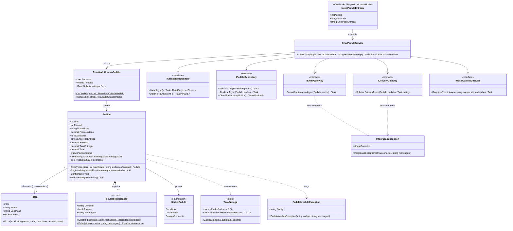

# PizzariaByte — Quatro Arquiteturas Didáticas em .NET 10 (MVC, Hexagonal, Onion e Hexagonal+Onion+MVC)

## Requirements

- Criar quatro soluções .NET 10 independentes, executáveis e testáveis em `./mvc`, `./hexagonal`, `./onion` e `./hexagonal_onion_mvc`. As quatro implementam o mesmo caso de uso, "realizar pedido de pizza", da pizzaria fictícia **PizzariaByte**.
- Demonstrar para estudantes iniciantes como cada arquitetura organiza responsabilidades, direção de dependências, regras de negócio, persistência e integrações externas. A comparação se apoia em um **contrato funcional comum** e idêntico nos quatro projetos: mesmo cardápio, mesmas regras, mesmas entradas, mesmos resultados.
- Garantir um fluxo completo e observável de ponta a ponta: página inicial → cardápio → escolha da pizza → quantidade e endereço → confirmação → resumo com total e status das integrações.
- Usar persistência em memória e três conectores simulados (`ApiEmail`, `ApiDeliveryAiQFome` e `ApiMObservabilidade`), substituíveis via injeção de dependência nativa e sem nenhum acesso à internet.
- Entregar cada projeto com testes xUnit, README em português (13 tópicos), diagrama Mermaid fiel à implementação e configuração de depuração. Na raiz, um README comparativo com a sequência de ensino.
- **Fora de escopo**: autenticação, carrinho com múltiplos itens, checkout real, cadastro de usuários, bancos de dados externos, Docker, listagem/histórico de pedidos e chamadas HTTP reais.

### Contrato funcional comum (idêntico nos quatro projetos)

| Item | Definição |
|------|-----------|
| Cardápio inicial | `1` Margherita — "Molho de tomate, muçarela e manjericão" — **R$ 45,00**<br>`2` Calabresa — "Molho de tomate, muçarela, calabresa e cebola" — **R$ 50,00**<br>`3` Quatro Queijos — "Muçarela, provolone, parmesão e gorgonzola" — **R$ 55,00** |
| Itens por pedido | Exatamente **uma** pizza (com quantidade) |
| Quantidade | Inteiro entre **1 e 50** (inclusive) |
| Endereço | Obrigatório. Sem espaços nas pontas (trim), não vazio, **máx. 200** caracteres |
| Subtotal | `PrecoUnitario × Quantidade` (`decimal`) |
| Taxa de entrega | **R$ 8,00**. **Isenta (R$ 0,00) quando Subtotal ≥ R$ 100,00** |
| Total | `Subtotal + TaxaEntrega` |
| Identificador | `Guid` gerado na criação do pedido |
| Status inicial | `Recebido` |
| Status final | `Confirmado` se a entrega foi solicitada com sucesso. `EntregaPendente` se a `ApiDeliveryAiQFome` falhou. A falha de e-mail **não** muda o status do pedido, só o resultado da integração |
| Ordem de efeitos | validar → criar → persistir (`Recebido`) → e-mail → entrega → definir status → atualizar persistência |
| Observabilidade | Eventos `PedidoRejeitado`, `PedidoCriado`, `PedidoPersistido`, `FalhaIntegracao` e `PedidoFinalizado`. Best-effort: uma falha da observabilidade nunca altera o resultado |
| Falha simulada | `appsettings.json` → `Integracoes:ApiEmail:SimularFalha` e `Integracoes:ApiDeliveryAiQFome:SimularFalha` (padrão `false`) |

**Mensagens (pt-BR, idênticas nos quatro projetos)**

| Código | Mensagem |
|--------|----------|
| `QUANTIDADE_INVALIDA` | "A quantidade deve ser maior que zero." |
| `QUANTIDADE_ACIMA_DO_LIMITE` | "A quantidade máxima por pedido é 50." |
| `ENDERECO_OBRIGATORIO` | "Informe o endereço de entrega." |
| `ENDERECO_MUITO_LONGO` | "O endereço deve ter no máximo 200 caracteres." |
| `PIZZA_INEXISTENTE` | "A pizza selecionada não existe no cardápio." |
| Sucesso total | "Pedido realizado com sucesso!" |
| Sucesso parcial | "Pedido registrado, mas houve falha em uma ou mais integrações. Veja os detalhes abaixo." |
| Pedido não encontrado | "Pedido não encontrado. Lembre-se: os dados ficam em memória e são perdidos quando a aplicação é reiniciada." |
| `ApiEmail` ok / falha | "Confirmação enviada por e-mail." / "Não foi possível enviar o e-mail de confirmação." |
| `ApiDeliveryAiQFome` ok / falha | "Entrega solicitada. Protocolo: {protocolo}." / "Não foi possível solicitar a entrega. O pedido ficou com entrega pendente." |

**Cenários de referência (entradas → resultado esperado)**

| # | Entrada (pizzaId, quantidade, endereço, falhas) | Resultado |
|---|-------------------------------------------------|-----------|
| C1 | 1, 2, "Rua das Flores, 123", nenhuma | Subtotal 90,00 · Taxa 8,00 · Total **98,00** · `Confirmado` · persistido |
| C2 | 2, 2, "Rua das Flores, 123", nenhuma | Subtotal 100,00 · Taxa **0,00** · Total **100,00** · `Confirmado` |
| C3 | 3, 1, "Av. Brasil, 500", nenhuma | Subtotal 55,00 · Taxa 8,00 · Total **63,00** · `Confirmado` |
| C4 | 1, 0 (ou -1), "Rua A, 1" | Rejeitado · `QUANTIDADE_INVALIDA` · **não** persistido |
| C5 | 99, 1, "Rua A, 1" | Rejeitado · `PIZZA_INEXISTENTE` · **não** persistido |
| C6 | 1, 1, "   " | Rejeitado · `ENDERECO_OBRIGATORIO` · **não** persistido |
| C7 | 1, 2, "Rua A, 1", e-mail falha | Total 98,00 · `Confirmado` · ApiEmail = falha · persistido |
| C8 | 1, 2, "Rua A, 1", entrega falha | Total 98,00 · `EntregaPendente` · ApiDeliveryAiQFome = falha · persistido |

## Entities



**Observações de modelagem**

- Os nomes e contratos acima valem nos quatro projetos. Mudam apenas o **namespace**, o **projeto/pasta** em que cada tipo vive e o nome do caso de uso no projeto combinado (`CriarPedidoUseCase`). Ver *Structure*.
- `Pedido` copia `NomePizza` e `PrecoUnitario` no momento da criação. Ele não guarda referência ao objeto `Pizza`, o que mantém o total estável e simplifica o repositório.
- `Pedido` é criado só pela fábrica `Criar` (construtor privado). As propriedades têm `private set`, e `Integracoes` é exposto como `IReadOnlyList`.
- `NovoPedidoEntrada` é o modelo de entrada da UI. Chama-se `NovoPedidoViewModel` nos projetos MVC e `NovoPedidoInput` (classe aninhada ao PageModel) nos projetos Razor Pages. Ele **nunca** é passado para o domínio. O controller/page extrai os três valores primitivos.
- No Hexagonal e no Combinado também existem as portas de entrada `ICriarPedidoUseCase` e `IConsultasPizzariaUseCase` (ver *Structure*).

## Approach

1. **Organização da solução e paridade**:
   - Quatro soluções autônomas. Cada diretório tem `global.json`, `.sln` (formato clássico, gerado com `dotnet new sln --format sln`), `src/`, `tests/`, `.vscode/` e `README.md`. Não há código compartilhado entre os diretórios: a paridade vem do **contrato funcional comum** acima, replicado e documentado no README raiz.
   - O primeiro projeto implementado (MVC) serve de referência de comportamento. Os seguintes reproduzem os mesmos cenários C1–C8 nos testes.
   - Raiz com `README.md` comparativo, `.gitignore` padrão .NET e `.vscode/` com uma configuração de depuração por projeto.

2. **Diferenciação arquitetural** (o que cada projeto deve deixar evidente):
   - **MVC** (`./mvc`): um único projeto `Microsoft.NET.Sdk.Web`. O "M" inclui as entidades (`Models/`), o serviço de modelo (`Services/CriarPedidoService`), o acesso a dados (`Data/`) e as integrações (`Integrations/`). Os Controllers só coordenam (recebem a entrada, chamam o serviço, escolhem a View). As Views só apresentam. As interfaces existem para a DI e para os testes, mas sem o vocabulário de portas e adaptadores.
   - **Hexagonal** (`./hexagonal`): o projeto `Core` contém o domínio, os casos de uso e as **portas** (`Portas/Entrada` e `Portas/Saida`), sem nenhuma referência externa. Os **adaptadores** ficam em projetos próprios: `Adapters.Persistencia`, `Adapters.Integracoes` (saída) e `Adapters.Web` (entrada, Razor Pages, que também é o host e a raiz de composição). Todos referenciam o `Core`, e o `Core` não referencia ninguém. A troca de adaptador é demonstrada pelo `Program.cs` e pelos fakes de teste ("um fake de teste é só mais um adaptador").
   - **Onion** (`./onion`): anéis como projetos `Domain` ← `Application` ← `Infrastructure` ← `Web`. As interfaces de repositório ficam no `Domain`, porque descrevem coleções de entidades do domínio. As interfaces de gateways externos ficam na `Application`, porque são necessidades do caso de uso. A `Infrastructure` implementa as duas. A `Web` (Razor Pages) é o anel externo e a raiz de composição. Os serviços de aplicação são classes concretas, sem interface de "porta de entrada", o que contrasta deliberadamente com o Hexagonal.
   - **Combinado** (`./hexagonal_onion_mvc`): **Onion** define os projetos e a direção (`Domain` ← `Application` ← `Adapters.Outbound` / `Web`). **Hexagonal** define as `Ports/Entrada` e `Ports/Saida` dentro da `Application` e os adaptadores em `Adapters.Outbound`. **MVC** organiza o `Web` (Controllers + ViewModels + Views), que é o adaptador de entrada. Sem camadas extras: não existe projeto "Contracts", "Shared" nem "Infrastructure" separado de `Adapters.Outbound`.

3. **Implementação técnica**:
   - .NET 10 (`net10.0`), `Nullable` e `ImplicitUsings` habilitados, DI nativa do ASP.NET Core e **nenhum pacote NuGet** nos projetos de produção. Nos testes, só os pacotes do template `dotnet new xunit` (xunit, xunit.runner.visualstudio, Microsoft.NET.Test.Sdk e coverlet.collector), justificados no README.
   - Front-end montado à mão (sem Bootstrap e sem jQuery), com um `wwwroot/css/site.css` pequeno e compartilhado conceitualmente (o mesmo conteúdo nos quatro projetos). A validação é no servidor (DataAnnotations no modelo de entrada + validação do domínio).
   - Post-Redirect-Get: o POST que cria o pedido redireciona para a página de resumo `GET /pedidos/{id}`, o que evita pedidos duplicados com F5.
   - Cultura `pt-BR` fixada via `app.UseRequestLocalization("pt-BR")` e formatação monetária `ToString("C")`. Os testes comparam `decimal`, nunca strings formatadas.
   - Somente HTTP no perfil de desenvolvimento, com portas fixas (MVC **5101**, Hexagonal **5102**, Onion **5103**, Combinado **5104**). Isso evita depender de `dev-certs` e permite rodar os quatro ao mesmo tempo.
   - Ciclos de vida na DI: `ICardapioRepository` e `IPedidoRepository` como **Singleton** (o estado precisa sobreviver entre requisições). O caso de uso e os três gateways como **Scoped**.
   - Tratamento global de exceções: `app.UseExceptionHandler("/Erro")` fora de Development, com uma página amigável ("Ocorreu um erro inesperado. Tente novamente."), e `DeveloperExceptionPage` (padrão) em Development. Erros de negócio **não** passam por aqui: eles chegam como `ResultadoCriacaoPedido.Falha`.
   - Conectores mock: implementam a abstração diretamente, sem `HttpClient`. Escrevem uma linha no console (`[ApiEmail] ...`) para que o fluxo seja visível em aula e lançam `IntegracaoException` quando `SimularFalha = true`. A configuração é lida no `Program.cs` e passada ao construtor por um `record ConfiguracaoMock(bool SimularFalha)`, sem pacote de Options.

4. **Lógica de negócio**:
   - Invariantes no domínio: `Pedido.Criar` valida quantidade e endereço e lança `PedidoInvalidoException(codigo, mensagem)`. `TaxaEntrega.Calcular` é uma função pura.
   - O caso de uso converte as falhas de negócio em `ResultadoCriacaoPedido.Falha`. A UI nunca precisa capturar exceções de negócio.
   - Cada integração é isolada em seu próprio `try/catch`. A falha de e-mail não impede a entrega, e a falha de entrega não desfaz o pedido. O status final reflete a entrega.
   - A observabilidade passa por um método privado `RegistrarEventoComSegurancaAsync`, que engole e escreve no console qualquer falha do próprio conector.
   - A pizza inexistente é verificada no caso de uso (consulta ao `ICardapioRepository`) antes de criar o pedido. Pedidos rejeitados nunca chegam ao repositório.

5. **Riscos e respostas**:
   - Erosão arquitetural (projetos parecidos demais): vocabulário e projetos próprios por arquitetura, mais uma tabela "o que muda" no README raiz.
   - Diagramas divergentes: os diagramas Mermaid são escritos **depois** do código e conferidos contra as `ProjectReference` reais.
   - `.slnx` gerado por engano: `--format sln` obrigatório e verificação de que o arquivo `.sln` existe.
   - Testes com estado compartilhado: nenhum `static` mutável. Cada teste cria seus próprios fakes.

## Structure

### Inheritance Relationships

1. `ICardapioRepository` define a leitura do cardápio (listar e obter por id). É implementada por `CardapioEmMemoriaRepository` (MVC/Onion) ou `CardapioEmMemoriaAdapter` (Hexagonal/Combinado) e por `FakeCardapioRepository` (testes).
2. `IPedidoRepository` define adicionar, atualizar e obter pedidos. É implementada por `PedidoEmMemoriaRepository` (MVC/Onion) ou `PedidoEmMemoriaAdapter` (Hexagonal/Combinado) e por `FakePedidoRepository` (testes).
3. `IEmailGateway` define o envio da confirmação. É implementada por `ApiEmail` e por `FakeEmailGateway`.
4. `IDeliveryGateway` define a solicitação de entrega e retorna o protocolo. É implementada por `ApiDeliveryAiQFome` e por `FakeDeliveryGateway`.
5. `IObservabilityGateway` define o registro de eventos. É implementada por `ApiMObservabilidade` e por `FakeObservabilityGateway`.
6. `ICriarPedidoUseCase` (porta de entrada, só no Hexagonal e no Combinado) é implementada por `CriarPedidoService` (Hexagonal) ou `CriarPedidoUseCase` (Combinado).
7. `IConsultasPizzariaUseCase` (porta de entrada, só no Hexagonal e no Combinado) é implementada por `ConsultasPizzariaService` (Hexagonal) ou `ConsultasPizzariaUseCase` (Combinado). No MVC e na Onion existe só a classe concreta `ConsultasPizzariaService`.
8. `PedidoInvalidoException` herda de `Exception` (exceção de domínio com `Codigo`).
9. `IntegracaoException` herda de `Exception` (falha de conector com `Conector`).
10. `HomeController`, `CardapioController`, `PedidosController` e `ErroController` herdam de `Controller` (projetos MVC). `IndexModel`, `CardapioModel`, `NovoModel`, `ResumoModel` e `ErroModel` herdam de `PageModel` (projetos Razor Pages).

### Dependencies

1. `CriarPedidoService` / `CriarPedidoUseCase` depende de `ICardapioRepository`, `IPedidoRepository`, `IEmailGateway`, `IDeliveryGateway` e `IObservabilityGateway`, todos via construtor.
2. `ConsultasPizzariaService` / `ConsultasPizzariaUseCase` depende de `ICardapioRepository` e `IPedidoRepository`.
3. `Pedido` usa `TaxaEntrega`, `StatusPedido`, `ResultadoIntegracao` e `PedidoInvalidoException`, e recebe `Pizza` como argumento da fábrica.
4. Controllers e PageModels injetam o caso de uso de criação e o serviço de consultas: as interfaces de porta no Hexagonal e no Combinado, as classes concretas no MVC e na Onion.
5. `Program.cs` (raiz de composição) registra todas as implementações e lê `Integracoes:*:SimularFalha`.
6. Os testes instanciam o caso de uso **diretamente** com fakes, sem contêiner de DI e sem ASP.NET.

### Layered Architecture (por projeto)

**`./mvc` — PizzariaByte.Mvc**

```
mvc/
├── PizzariaByte.Mvc.sln
├── global.json
├── README.md
├── .vscode/{launch.json,tasks.json}
├── src/PizzariaByte.Mvc/                   (Microsoft.NET.Sdk.Web)
│   ├── Program.cs                          raiz de composição (DI + pipeline)
│   ├── appsettings.json / appsettings.Development.json
│   ├── Properties/launchSettings.json      http://localhost:5101
│   ├── Controllers/  HomeController, CardapioController, PedidosController, ErroController
│   ├── Models/       Pizza, Pedido, StatusPedido, ResultadoIntegracao, TaxaEntrega,
│   │                 PedidoInvalidoException, ResultadoCriacaoPedido,
│   │                 NovoPedidoViewModel
│   ├── Services/     CriarPedidoService, ConsultasPizzariaService
│   ├── Data/         ICardapioRepository, CardapioEmMemoriaRepository,
│   │                 IPedidoRepository, PedidoEmMemoriaRepository
│   ├── Integrations/ IEmailGateway, ApiEmail, IDeliveryGateway, ApiDeliveryAiQFome,
│   │                 IObservabilityGateway, ApiMObservabilidade,
│   │                 IntegracaoException, ConfiguracaoMock
│   ├── Views/        _ViewImports, _ViewStart, Shared/_Layout,
│   │                 Home/Index, Cardapio/Index, Pedidos/Novo, Pedidos/Resumo,
│   │                 Pedidos/NaoEncontrado, Erro/Index
│   └── wwwroot/css/site.css
└── tests/PizzariaByte.Mvc.Tests/          (xUnit → ref PizzariaByte.Mvc)
    ├── Fakes/  FakeCardapioRepository, FakePedidoRepository, FakeEmailGateway,
    │           FakeDeliveryGateway, FakeObservabilityGateway
    ├── CriarPedidoServiceTests.cs
    └── PedidoTests.cs
```
1. Controller: recebe as requisições HTTP, valida o `ModelState`, chama os serviços, escolhe a View e faz o redirect PRG.
2. Model (Models + Services + Data + Integrations): dados, regras, orquestração do caso de uso, persistência e conectores.
3. View: Razor `.cshtml`, só apresentação. Recebe `IReadOnlyList<Pizza>`, `NovoPedidoViewModel` ou `Pedido`.

**`./hexagonal` — PizzariaByte.Hexagonal**

```
hexagonal/src/
├── PizzariaByte.Hexagonal.Core/                  (classlib, SEM referências)
│   ├── Dominio/        Pizza, Pedido, StatusPedido, ResultadoIntegracao, TaxaEntrega,
│   │                   PedidoInvalidoException
│   ├── Portas/Entrada/ ICriarPedidoUseCase, IConsultasPizzariaUseCase, ResultadoCriacaoPedido
│   ├── Portas/Saida/   ICardapioRepository, IPedidoRepository, IEmailGateway,
│   │                   IDeliveryGateway, IObservabilityGateway, IntegracaoException
│   └── Aplicacao/      CriarPedidoService, ConsultasPizzariaService
├── PizzariaByte.Hexagonal.Adapters.Persistencia/ (classlib → Core)
│   └── CardapioEmMemoriaAdapter, PedidoEmMemoriaAdapter
├── PizzariaByte.Hexagonal.Adapters.Integracoes/  (classlib → Core)
│   └── ApiEmail, ApiDeliveryAiQFome, ApiMObservabilidade, ConfiguracaoMock
└── PizzariaByte.Hexagonal.Adapters.Web/          (Sdk.Web → Core, Persistencia, Integracoes)
    ├── Program.cs  (raiz de composição: liga portas a adaptadores)
    ├── Properties/launchSettings.json  http://localhost:5102
    ├── Pages/  _ViewImports, _ViewStart, Shared/_Layout, Index, Cardapio,
    │           Pedidos/Novo, Pedidos/Resumo, Erro
    └── wwwroot/css/site.css
hexagonal/tests/PizzariaByte.Hexagonal.Tests/      (xUnit → Core apenas)
```
1. Adaptador de entrada (Web/Razor Pages): traduz HTTP para chamadas às portas de entrada.
2. Núcleo (Core): domínio, casos de uso e definição das portas.
3. Adaptadores de saída: implementam as portas de saída (memória e mocks).
4. As referências do `Adapters.Web` aos adaptadores de saída existem **somente** para a composição em `Program.cs`. Isso fica documentado com um comentário.

**`./onion` — PizzariaByte.Onion**

```
onion/src/
├── PizzariaByte.Onion.Domain/          (classlib, SEM referências) — centro
│   ├── Entidades/     Pizza, Pedido, StatusPedido, ResultadoIntegracao
│   ├── Servicos/      TaxaEntrega
│   ├── Excecoes/      PedidoInvalidoException
│   └── Repositorios/  ICardapioRepository, IPedidoRepository
├── PizzariaByte.Onion.Application/     (classlib → Domain)
│   ├── Interfaces/    IEmailGateway, IDeliveryGateway, IObservabilityGateway, IntegracaoException
│   └── Pedidos/       CriarPedidoService, ConsultasPizzariaService, ResultadoCriacaoPedido
├── PizzariaByte.Onion.Infrastructure/  (classlib → Application, Domain)
│   ├── Persistencia/  CardapioEmMemoriaRepository, PedidoEmMemoriaRepository
│   └── Integracoes/   ApiEmail, ApiDeliveryAiQFome, ApiMObservabilidade, ConfiguracaoMock
└── PizzariaByte.Onion.Web/             (Sdk.Web → Application, Infrastructure)
    ├── Program.cs     raiz de composição
    ├── Properties/launchSettings.json  http://localhost:5103
    ├── Pages/ (mesmo conjunto do Hexagonal)
    └── wwwroot/css/site.css
onion/tests/PizzariaByte.Onion.Tests/   (xUnit → Application, Domain)
```
1. Domain (núcleo): entidades, regra de taxa, exceções e contratos de repositório.
2. Application: casos de uso e contratos dos serviços externos.
3. Infrastructure: implementações de persistência e integrações.
4. Web (anel externo): apresentação Razor Pages e composição da DI.

**`./hexagonal_onion_mvc` — PizzariaByte.Combined**

```
hexagonal_onion_mvc/
├── PizzariaByte.Combined.sln
└── src/
    ├── PizzariaByte.Combined.Domain/            (classlib, SEM referências) — Onion: centro
    │   └── Pizza, Pedido, StatusPedido, ResultadoIntegracao, TaxaEntrega, PedidoInvalidoException
    ├── PizzariaByte.Combined.Application/       (classlib → Domain) — Onion: aplicação
    │   ├── Ports/Entrada/  ICriarPedidoUseCase, IConsultasPizzariaUseCase, ResultadoCriacaoPedido   ← Hexagonal
    │   ├── Ports/Saida/    ICardapioRepository, IPedidoRepository, IEmailGateway,
    │   │                   IDeliveryGateway, IObservabilityGateway, IntegracaoException            ← Hexagonal
    │   └── UseCases/       CriarPedidoUseCase, ConsultasPizzariaUseCase
    ├── PizzariaByte.Combined.Adapters.Outbound/ (classlib → Application) — Hexagonal: adaptadores de saída
    │   ├── Persistencia/  CardapioEmMemoriaAdapter, PedidoEmMemoriaAdapter
    │   └── Integracoes/   ApiEmail, ApiDeliveryAiQFome, ApiMObservabilidade, ConfiguracaoMock
    └── PizzariaByte.Combined.Web/               (Sdk.Web → Application, Adapters.Outbound) — MVC + adaptador de entrada
        ├── Program.cs
        ├── Properties/launchSettings.json  http://localhost:5104
        ├── Controllers/  HomeController, CardapioController, PedidosController, ErroController
        ├── Models/       NovoPedidoViewModel, ResumoPedidoViewModel   (Models de apresentação)
        ├── Views/        (mesmo conjunto do MVC)
        └── wwwroot/css/site.css
hexagonal_onion_mvc/tests/PizzariaByte.Combined.Tests/  (xUnit → Application, Domain)
```
1. MVC (Web): Controllers coordenam, ViewModels transportam dados de tela e Views apresentam. É o adaptador de entrada hexagonal.
2. Ports (Application): contratos de entrada e saída.
3. Use cases (Application): orquestração, que depende só das portas e do Domain.
4. Domain: regras puras.
5. Adapters.Outbound: implementações de saída.
6. No MVC puro o "Model" é o domínio. Aqui os Models do MVC são **só de apresentação** (`ResumoPedidoViewModel` mapeado a partir de `Pedido`), o que evita duplicar a responsabilidade do domínio. Esse ponto deve ser explicado no README.

**Raiz do repositório**

```
./README.md   ./.gitignore   ./.vscode/{launch.json,tasks.json}
./mvc  ./hexagonal  ./onion  ./hexagonal_onion_mvc
```

## Operations

> Ordem de execução: **O1** (raiz) → **O2** (contrato de domínio comum, escrito primeiro no MVC) → **O3** (MVC completo + testes + validação) → **O4** (Hexagonal) → **O5** (Onion) → **O6** (Combinado) → **O7** (documentação raiz e diagramas) → **O8** (validação final). As operações O4–O6 reutilizam as especificações de O2 e mudam apenas namespaces e localização, conforme *Structure*.

### O1. Create Repository Scaffolding — raiz

1. Responsibility: preparar a raiz para quatro soluções independentes.
2. Tarefas:
   - Criar `.gitignore` com `dotnet new gitignore` na raiz (ignora `bin/`, `obj/`, `.vs/`, `*.user`, `TestResults/`).
   - Em cada diretório de projeto (`mvc`, `hexagonal`, `onion`, `hexagonal_onion_mvc`), criar `global.json`:
     ```json
     { "sdk": { "version": "10.0.100", "rollForward": "latestFeature" } }
     ```
   - Criar cada solução com `dotnet new sln --format sln -n <NomeDaSolucao>` dentro do diretório. Nomes: `PizzariaByte.Mvc`, `PizzariaByte.Hexagonal`, `PizzariaByte.Onion` e `PizzariaByte.Combined`.
   - Projetos criados com `dotnet new classlib|web|xunit -n <Nome> -o src/<Nome>` (ou `tests/<Nome>`) e `-f net10.0`. Remover `Class1.cs`/`UnitTest1.cs` gerados. Adicionar ao `.sln` com `dotnet sln add`. As referências entre projetos são criadas com `dotnet add reference`, exatamente conforme *Structure*.
   - Nos projetos web, usar o template `web` (vazio) e criar à mão as pastas Controllers/Views ou Pages, sem Bootstrap e sem jQuery.
3. Completion: `ls */*.sln` lista quatro arquivos `.sln` e nenhum `.slnx`.

### O2. Create Domain Contract — tipos comuns (escritos no MVC e replicados)

#### O2.1 Create Entity — `Pizza`
1. Responsibility: item imutável do cardápio.
2. Attributes: `Id: int`, `Nome: string`, `Descricao: string`, `Preco: decimal`. Todas get-only.
3. Constructor: `Pizza(int id, string nome, string descricao, decimal preco)`. Lança `ArgumentException` se `preco <= 0` ou se `nome` estiver vazio. É um erro de programação no seed, não um erro de negócio do usuário.
4. Form: `public sealed class` (ou `sealed record` com validação, a critério do código, desde que seja igual nos quatro projetos).

#### O2.2 Create Enum — `StatusPedido`
- Valores, nesta ordem: `Recebido`, `Confirmado`, `EntregaPendente`.
- Comentário em português explicando quando cada status ocorre (ver contrato).

#### O2.3 Create Record — `ResultadoIntegracao`
1. `public sealed record ResultadoIntegracao(string Conector, bool Sucesso, string Mensagem)`.
2. Fábricas estáticas: `Ok(string conector, string mensagem)` e `Falha(string conector, string mensagem)`.

#### O2.4 Create Domain Rule — `TaxaEntrega`
1. Responsibility: regra única e pura da taxa de entrega.
2. Members: `public const decimal ValorPadrao = 8.00m`, `public const decimal SubtotalMinimoParaIsencao = 100.00m`.
3. Method: `public static decimal Calcular(decimal subtotal)`.
   - Logic: `return subtotal >= SubtotalMinimoParaIsencao ? 0m : ValorPadrao;`
4. Comentário obrigatório: explica que `static` é adequado aqui porque é uma função pura, sem estado e sem dependências externas, e que isso **não** é um atalho para evitar DI.

#### O2.5 Create Exception — `PedidoInvalidoException`
1. Inheritance: `Exception`.
2. Attributes: `Codigo: string` (ex.: `QUANTIDADE_INVALIDA`).
3. Constructor: `PedidoInvalidoException(string codigo, string mensagem) : base(mensagem)`.
4. Usage: lançada só por `Pedido.Criar` e capturada só pelo caso de uso.

#### O2.6 Create Exception — `IntegracaoException`
1. Inheritance: `Exception`.
2. Attributes: `Conector: string`.
3. Constructor: `IntegracaoException(string conector, string mensagem) : base(mensagem)`.
4. Usage: lançada pelos conectores mock quando `SimularFalha = true`. É o tipo que um conector real também deveria usar para encapsular falhas técnicas.

#### O2.7 Create Aggregate — `Pedido`
1. Responsibility: agregado do pedido, que garante as invariantes RN02, RN04, RN05, RN06 e RI01–RI03.
2. Attributes (todos `{ get; private set; }`): `Id: Guid`, `PizzaId: int`, `NomePizza: string`, `PrecoUnitario: decimal`, `Quantidade: int`, `EnderecoEntrega: string`, `Subtotal: decimal`, `TaxaEntrega: decimal`, `Total: decimal`, `Status: StatusPedido`. Mais o campo privado `List<ResultadoIntegracao> _integracoes`, exposto como `IReadOnlyList<ResultadoIntegracao> Integracoes => _integracoes;`.
3. Constants: `public const int QuantidadeMaxima = 50;` e `public const int TamanhoMaximoEndereco = 200;`.
4. Methods:
   - `public static Pedido Criar(Pizza pizza, int quantidade, string enderecoEntrega)`
     - Logic:
       1. `ArgumentNullException.ThrowIfNull(pizza)`.
       2. `quantidade <= 0` → `throw new PedidoInvalidoException("QUANTIDADE_INVALIDA", "A quantidade deve ser maior que zero.")`.
       3. `quantidade > QuantidadeMaxima` → `PedidoInvalidoException("QUANTIDADE_ACIMA_DO_LIMITE", "A quantidade máxima por pedido é 50.")`.
       4. `var endereco = enderecoEntrega?.Trim() ?? ""`. Se estiver vazio → `PedidoInvalidoException("ENDERECO_OBRIGATORIO", "Informe o endereço de entrega.")`.
       5. `endereco.Length > TamanhoMaximoEndereco` → `PedidoInvalidoException("ENDERECO_MUITO_LONGO", "O endereço deve ter no máximo 200 caracteres.")`.
       6. `subtotal = pizza.Preco * quantidade`, `taxa = global::...TaxaEntrega.Calcular(subtotal)` (qualificar o nome se a propriedade `TaxaEntrega` ocultar a classe; alternativa: `using RegraTaxa = ...TaxaEntrega;`), `total = subtotal + taxa`.
       7. Retornar o novo `Pedido` com `Id = Guid.NewGuid()`, `Status = StatusPedido.Recebido`, `NomePizza = pizza.Nome` e `PrecoUnitario = pizza.Preco`.
   - `public void RegistrarIntegracao(ResultadoIntegracao resultado)`: faz `ArgumentNullException.ThrowIfNull` e `_integracoes.Add(resultado)`.
   - `public void Confirmar()`: `Status = StatusPedido.Confirmado`.
   - `public void MarcarEntregaPendente()`: `Status = StatusPedido.EntregaPendente`.
   - `public bool PossuiFalhaDeIntegracao => _integracoes.Any(i => !i.Sucesso);`
5. Constraints: construtor privado. Nenhuma dependência de ASP.NET, de DI ou de I/O.

#### O2.8 Create Result — `ResultadoCriacaoPedido`
1. Attributes: `Sucesso: bool`, `Pedido: Pedido?`, `Erros: IReadOnlyList<string>`.
2. Factories: `Ok(Pedido pedido)` (Sucesso = true, Erros vazio) e `Falha(string erro)` (Sucesso = false, Pedido = null, Erros = [erro]).
3. Construtor privado.

#### O2.9 Define Abstractions — repositórios e gateways
- `ICardapioRepository`: `Task<IReadOnlyList<Pizza>> ListarAsync();` e `Task<Pizza?> ObterPorIdAsync(int id);`
- `IPedidoRepository`: `Task AdicionarAsync(Pedido pedido);`, `Task AtualizarAsync(Pedido pedido);` e `Task<Pedido?> ObterPorIdAsync(Guid id);`
- `IEmailGateway`: `Task EnviarConfirmacaoAsync(Pedido pedido);`
- `IDeliveryGateway`: `Task<string> SolicitarEntregaAsync(Pedido pedido);`, que retorna o protocolo da entrega.
- `IObservabilityGateway`: `Task RegistrarEventoAsync(string evento, string detalhe);`
- Cada interface leva um comentário XML/linha em português explicando seu papel **no vocabulário da arquitetura** do projeto: "abstração de serviço" (MVC), "porta de saída" (Hexagonal/Combinado), "contrato de repositório do domínio" ou "contrato de serviço externo da aplicação" (Onion).

### O2.10 Implement Use Case — `CriarPedidoService` (`CriarPedidoUseCase` no Combinado)
1. Interface Definition: no Hexagonal e no Combinado implementa `ICriarPedidoUseCase { Task<ResultadoCriacaoPedido> CriarAsync(int pizzaId, int quantidade, string enderecoEntrega); }`. No MVC e na Onion é uma classe concreta com o mesmo método público.
2. Dependency Injection (construtor, campos `private readonly`): `ICardapioRepository cardapio`, `IPedidoRepository pedidos`, `IEmailGateway email`, `IDeliveryGateway delivery` e `IObservabilityGateway observabilidade`.
3. Constantes privadas de nome dos conectores: `"ApiEmail"`, `"ApiDeliveryAiQFome"`.
4. Core Method `public async Task<ResultadoCriacaoPedido> CriarAsync(int pizzaId, int quantidade, string enderecoEntrega)`:
   - Input validation / business logic:
     1. `var pizza = await _cardapio.ObterPorIdAsync(pizzaId);`
     2. Se `pizza is null`: `await RegistrarEventoComSegurancaAsync("PedidoRejeitado", $"Pizza {pizzaId} inexistente")` e `return ResultadoCriacaoPedido.Falha("A pizza selecionada não existe no cardápio.")`.
     3. `Pedido pedido;` `try { pedido = Pedido.Criar(pizza, quantidade, enderecoEntrega); }`. No `catch (PedidoInvalidoException ex)`: registrar `"PedidoRejeitado"` com `ex.Codigo` e `return ResultadoCriacaoPedido.Falha(ex.Message)`.
     4. Registrar `"PedidoCriado"` com `$"Pedido {pedido.Id} — {pedido.Quantidade}x {pedido.NomePizza} — total {pedido.Total}"`.
     5. `await _pedidos.AdicionarAsync(pedido);` e registrar `"PedidoPersistido"`.
     6. `await EnviarEmailAsync(pedido);` (ver abaixo).
     7. `var entregaSolicitada = await SolicitarEntregaAsync(pedido);`
     8. Se `entregaSolicitada`, chamar `pedido.Confirmar()`. Senão, `pedido.MarcarEntregaPendente()`.
     9. `await _pedidos.AtualizarAsync(pedido);` e registrar `"PedidoFinalizado"` com o status.
     10. `return ResultadoCriacaoPedido.Ok(pedido);`
   - Private methods:
     - `private async Task EnviarEmailAsync(Pedido pedido)`: `try { await _email.EnviarConfirmacaoAsync(pedido); pedido.RegistrarIntegracao(ResultadoIntegracao.Ok("ApiEmail", "Confirmação enviada por e-mail.")); }`. No `catch (Exception ex)`: `pedido.RegistrarIntegracao(ResultadoIntegracao.Falha("ApiEmail", "Não foi possível enviar o e-mail de confirmação."))` e registrar `"FalhaIntegracao"` com `$"ApiEmail: {ex.Message}"`.
     - `private async Task<bool> SolicitarEntregaAsync(Pedido pedido)`: `try { var protocolo = await _delivery.SolicitarEntregaAsync(pedido); pedido.RegistrarIntegracao(ResultadoIntegracao.Ok("ApiDeliveryAiQFome", $"Entrega solicitada. Protocolo: {protocolo}.")); return true; }`. No `catch (Exception ex)`: registrar a falha com a mensagem do contrato, registrar `"FalhaIntegracao"` e `return false;`.
     - `private async Task RegistrarEventoComSegurancaAsync(string evento, string detalhe)`: `try { await _observabilidade.RegistrarEventoAsync(evento, detalhe); } catch (Exception ex) { Console.WriteLine($"[Aviso] Falha ao registrar observabilidade: {ex.Message}"); }`.
   - Exception Handling: o `catch (Exception)` nas integrações é **intencional** e fica documentado com um comentário. É a fronteira com sistemas externos, e qualquer falha técnica deve virar resultado de integração, não erro do pedido. Exceções do repositório **não** são capturadas e propagam até o handler global.
   - Return Value: `ResultadoCriacaoPedido`.
5. Transaction Management: não há transação. A consistência vem da ordem dos efeitos: o pedido só é persistido depois de validado, as integrações só rodam depois da persistência e o status final é gravado com `AtualizarAsync`. Comentário em português no topo da classe explicando essa política (RN08).

### O2.11 Implement Query Service — `ConsultasPizzariaService` (`ConsultasPizzariaUseCase` no Combinado)
1. Interface (Hexagonal/Combinado): `IConsultasPizzariaUseCase { Task<IReadOnlyList<Pizza>> ListarCardapioAsync(); Task<Pizza?> ObterPizzaAsync(int id); Task<Pedido?> ObterPedidoAsync(Guid id); }`
2. Dependencies: `ICardapioRepository` e `IPedidoRepository`.
3. Methods: só delegam ao repositório correspondente. Existem para que Controllers e Pages não falem direto com repositórios.

### O2.12 Implement Adapters — persistência em memória
- `CardapioEmMemoriaRepository` / `CardapioEmMemoriaAdapter`: campo `private readonly IReadOnlyList<Pizza> _pizzas`, iniciado no construtor com as três pizzas do contrato (ids 1, 2 e 3). `ListarAsync` retorna `Task.FromResult(_pizzas)`. `ObterPorIdAsync` retorna `Task.FromResult(_pizzas.FirstOrDefault(p => p.Id == id))`. Comentário: "dados previsíveis, recriados a cada inicialização".
- `PedidoEmMemoriaRepository` / `PedidoEmMemoriaAdapter`: campo `private readonly ConcurrentDictionary<Guid, Pedido> _pedidos = new();`. `AdicionarAsync` usa `TryAdd`, e se falhar lança `InvalidOperationException("Pedido já existe.")`. `AtualizarAsync` faz `_pedidos[pedido.Id] = pedido`. `ObterPorIdAsync` usa `TryGetValue`. Todos retornam `Task.CompletedTask`/`Task.FromResult`. Comentário: Singleton, os dados se perdem ao reiniciar e o `ConcurrentDictionary` existe por causa de requisições simultâneas.

### O2.13 Implement Adapters — conectores mock
- `public sealed record ConfiguracaoMock(bool SimularFalha);`
- `ApiEmail(ConfiguracaoMock configuracao) : IEmailGateway`
  - `EnviarConfirmacaoAsync(Pedido pedido)`: se `SimularFalha`, lança `IntegracaoException("ApiEmail", "Servidor de e-mail indisponível (falha simulada).")`. Senão, `Console.WriteLine($"[ApiEmail] Confirmação do pedido {pedido.Id} enviada (simulado).")` e `return Task.CompletedTask`.
- `ApiDeliveryAiQFome(ConfiguracaoMock configuracao) : IDeliveryGateway`
  - `SolicitarEntregaAsync(Pedido pedido)`: se `SimularFalha`, lança `IntegracaoException("ApiDeliveryAiQFome", "Serviço de entrega indisponível (falha simulada).")`. Senão, o protocolo é `$"AQF-{pedido.Id.ToString("N")[..8].ToUpperInvariant()}"`, o que dá um resultado determinístico por pedido. Escreve no console e retorna `Task.FromResult(protocolo)`.
- `ApiMObservabilidade : IObservabilityGateway`
  - `RegistrarEventoAsync(string evento, string detalhe)`: `Console.WriteLine($"[ApiMObservabilidade] {DateTime.UtcNow:O} {evento}: {detalhe}")` e `Task.CompletedTask`.
- Comentário em cada classe: "Simulação: nenhuma chamada de rede. Para usar um serviço real, crie outra classe que implemente a mesma interface e troque o registro em Program.cs."

### O2.14 Create Test Fakes (cada projeto de testes, pasta `Fakes/`)
- `FakeCardapioRepository : ICardapioRepository`: as mesmas três pizzas do contrato.
- `FakePedidoRepository : IPedidoRepository`: `public List<Pedido> Pedidos { get; } = new();`, `public int Atualizacoes { get; private set; }`, implementação trivial.
- `FakeEmailGateway(bool falhar = false) : IEmailGateway`: `public int Chamadas { get; private set; }`. Lança `IntegracaoException` se `falhar`.
- `FakeDeliveryGateway(bool falhar = false) : IDeliveryGateway`: `Chamadas` e retorno `"FAKE-123"`.
- `FakeObservabilityGateway(bool falhar = false) : IObservabilityGateway`: `public List<string> Eventos { get; } = new();`. Lança `InvalidOperationException` se `falhar`.

### O2.15 Create Unit Tests (cada projeto de testes)
`CriarPedidoServiceTests` (ou `CriarPedidoUseCaseTests` no Combinado). Cada teste monta um SUT novo com o helper privado `CriarSut(...)`, que retorna a tupla (sut, fakes):
1. `CriarAsync_ComPizzaEQuantidadeValidas_CalculaTotalEPersistePedido`: cenário C1. Assert `Sucesso`, `Subtotal == 90m`, `TaxaEntrega == 8m`, `Total == 98m`, `Status == Confirmado`, `repo.Pedidos.Count == 1`. **(obrigatório)**
2. `CriarAsync_ComQuantidadeZeroOuNegativa_RejeitaENaoPersiste`: `[Theory]` com `[InlineData(0)]` e `[InlineData(-1)]`. Assert `!Sucesso`, a mensagem do contrato, `repo.Pedidos` vazio, `email.Chamadas == 0` e `delivery.Chamadas == 0`. **(obrigatório)**
3. `CriarAsync_ComPizzaInexistente_RejeitaENaoPersiste`: C5.
4. `CriarAsync_ComEnderecoEmBranco_RejeitaENaoPersiste`: C6.
5. `CriarAsync_ComQuantidadeAcimaDoLimite_RejeitaENaoPersiste`: quantidade 51.
6. `CriarAsync_QuandoEmailFalha_PedidoContinuaConfirmadoEFalhaEhRegistrada`: C7. Assert `Status == Confirmado`, integração ApiEmail `Sucesso == false`, persistido, `delivery.Chamadas == 1` e evento `FalhaIntegracao` presente.
7. `CriarAsync_QuandoEntregaFalha_PedidoFicaComEntregaPendente`: C8.
8. `CriarAsync_QuandoObservabilidadeFalha_PedidoEhCriadoNormalmente`.
9. `CriarAsync_PedidoValido_UtilizaAsAbstracoesInjetadas`: `email.Chamadas == 1`, `delivery.Chamadas == 1`, `repo.Atualizacoes == 1` e `obs.Eventos` contém, em ordem, `PedidoCriado`, `PedidoPersistido` e `PedidoFinalizado`.

`PedidoTests` / `TaxaEntregaTests`:
10. `Calcular_RetornaTaxaConformeSubtotal`: `[Theory]` com `(45.00, 8.00)`, `(99.99, 8.00)`, `(100.00, 0.00)` e `(165.00, 0.00)`. Como `decimal` não é constante de atributo, usar `double` no `InlineData` e converter, ou `[MemberData]`.
11. `Criar_ComDadosValidos_DefineIdEStatusInicialRecebido`: `Id != Guid.Empty` e `Status == Recebido`.
12. `Criar_DuasPizzasCalabresa_IsentaTaxa`: C2, total 100.

### O3. Implement Project — `./mvc`
1. Criar a estrutura de *Structure/mvc* com O1 e os tipos de O2 nos namespaces `PizzariaByte.Mvc.Models`, `.Services`, `.Data` e `.Integrations`.
2. `Models/NovoPedidoViewModel`:
   - `[Required(ErrorMessage = "Escolha uma pizza.")] [Display(Name = "Pizza")] public int? PizzaId`
   - `[Required(ErrorMessage = "Informe a quantidade.")] [Range(1, 50, ErrorMessage = "A quantidade deve estar entre 1 e 50.")] public int? Quantidade`
   - `[Required(ErrorMessage = "Informe o endereço de entrega.")] [StringLength(200, ErrorMessage = "O endereço deve ter no máximo 200 caracteres.")] [Display(Name = "Endereço de entrega")] public string? EnderecoEntrega`
   - `public IReadOnlyList<Pizza> Cardapio { get; set; } = [];`: para popular o `<select>`. Não é vinculado a partir do POST (`[BindNever]`).
   - Comentário: a validação da tela é uma primeira barreira amigável, e a regra de verdade está no domínio (`Pedido.Criar`).
3. Controllers:
   - `HomeController.Index()` → `View()`, com apresentação e link para o cardápio.
   - `CardapioController(ConsultasPizzariaService consultas)`, `Index()` → `View(await consultas.ListarCardapioAsync())`. Cada pizza tem o link "Pedir" para `/Pedidos/Novo?pizzaId={id}`.
   - `PedidosController(CriarPedidoService criarPedido, ConsultasPizzariaService consultas)`:
     - `[HttpGet] Novo(int? pizzaId)`: monta o ViewModel com o `Cardapio` e o `PizzaId` pré-selecionado. Retorna `View`.
     - `[HttpPost, ValidateAntiForgeryToken] Novo(NovoPedidoViewModel modelo)`: se `!ModelState.IsValid`, recarrega o `Cardapio` e devolve a `View(modelo)`. Senão, `var resultado = await criarPedido.CriarAsync(modelo.PizzaId!.Value, modelo.Quantidade!.Value, modelo.EnderecoEntrega!)`. Se for falha, `ModelState.AddModelError(string.Empty, erro)` para cada erro, recarrega o cardápio e devolve a `View`. Se for sucesso, `RedirectToAction(nameof(Resumo), new { id = resultado.Pedido!.Id })`.
     - `[HttpGet("Pedidos/{id:guid}")] Resumo(Guid id)`: busca o pedido. Se for `null`, `View("NaoEncontrado")`. Senão, `View(pedido)`.
   - `ErroController.Index()` → `View()`, com a mensagem amigável.
4. Views: `_Layout` (cabeçalho "🍕 PizzariaByte" com links Início/Cardápio, `<main>` e rodapé indicando a arquitetura "Projeto: MVC"). `Cardapio/Index` (tabela nome/descrição/preço `C`/link). `Pedidos/Novo` (`asp-validation-summary="All"`, `<select asp-for="PizzaId" asp-items>`, `<input asp-for="Quantidade" type="number" min="1" max="50">`, `<input asp-for="EnderecoEntrega">`, botão "Confirmar pedido"). `Pedidos/Resumo` (mensagem de sucesso total ou parcial segundo `Model.PossuiFalhaDeIntegracao`, tabela com id/pizza/quantidade/preço unitário/subtotal/taxa/total/endereço/status e uma lista de integrações com ✅/❌). `Pedidos/NaoEncontrado` (mensagem do contrato).
5. `Program.cs`:
   ```text
   builder.Services.AddControllersWithViews();
   var falhaEmail    = builder.Configuration.GetValue<bool>("Integracoes:ApiEmail:SimularFalha");
   var falhaDelivery = builder.Configuration.GetValue<bool>("Integracoes:ApiDeliveryAiQFome:SimularFalha");
   Singleton: ICardapioRepository→CardapioEmMemoriaRepository, IPedidoRepository→PedidoEmMemoriaRepository
   Scoped:    IEmailGateway→new ApiEmail(new ConfiguracaoMock(falhaEmail)),
              IDeliveryGateway→new ApiDeliveryAiQFome(new ConfiguracaoMock(falhaDelivery)),
              IObservabilityGateway→ApiMObservabilidade,
              CriarPedidoService, ConsultasPizzariaService
   if (!app.Environment.IsDevelopment()) app.UseExceptionHandler("/Erro");
   app.UseRequestLocalization("pt-BR"); app.UseStaticFiles(); app.UseRouting();
   app.MapControllerRoute("default", "{controller=Home}/{action=Index}/{id?}");
   ```
   Com um comentário em bloco explicando **como trocar** uma implementação (ex.: substituir `ApiEmail` por `SmtpEmailGateway`) e por que os repositórios são Singleton.
6. `appsettings.json`: seção `"Integracoes": { "ApiEmail": { "SimularFalha": false }, "ApiDeliveryAiQFome": { "SimularFalha": false } }` mais o `Logging` padrão.
7. `Properties/launchSettings.json`: perfil `http` com `applicationUrl: http://localhost:5101`, `ASPNETCORE_ENVIRONMENT=Development` e `launchBrowser: true`.
8. `.vscode/launch.json`: `type: coreclr`, `request: launch`, `preLaunchTask: build`, `program: ${workspaceFolder}/src/PizzariaByte.Mvc/bin/Debug/net10.0/PizzariaByte.Mvc.dll`, `cwd: ${workspaceFolder}/src/PizzariaByte.Mvc`, env `ASPNETCORE_ENVIRONMENT=Development` e `ASPNETCORE_URLS=http://localhost:5101`, e `serverReadyAction` abrindo o navegador. `.vscode/tasks.json`: tarefa `build` com `dotnet build ${workspaceFolder}/PizzariaByte.Mvc.sln` e `problemMatcher: $msCompile`. Mais uma tarefa `test`.
9. Testes (O2.14 e O2.15) em `tests/PizzariaByte.Mvc.Tests`, com referência ao projeto web.
10. `README.md` (O7.2).
11. Validação: `dotnet restore && dotnet build && dotnet test` dentro de `./mvc`, todos verdes. `dotnet run --project src/PizzariaByte.Mvc` sobe em 5101, e `curl -s http://localhost:5101/Cardapio` contém "Margherita".

### O4. Implement Project — `./hexagonal`
1. Estrutura de *Structure/hexagonal*. Os tipos de O2 vão para `PizzariaByte.Hexagonal.Core.Dominio`, `.Portas.Entrada`, `.Portas.Saida` e `.Aplicacao`, e os adaptadores com o sufixo `Adapter` para persistência.
2. `Core.csproj` **sem** `ProjectReference` nem `PackageReference`. Comentário no topo de `Portas/Saida/*.cs`: "Porta de saída — o núcleo define o que precisa; adaptadores fornecem."
3. `CriarPedidoService : ICriarPedidoUseCase` e `ConsultasPizzariaService : IConsultasPizzariaUseCase` (O2.10 e O2.11).
4. `Adapters.Web` com Razor Pages (`builder.Services.AddRazorPages()`, `app.MapRazorPages()`):
   - `Pages/Index.cshtml(.cs)`: boas-vindas.
   - `Pages/Cardapio.cshtml(.cs)`: `CardapioModel(IConsultasPizzariaUseCase consultas)` e `public IReadOnlyList<Pizza> Pizzas { get; private set; } = [];` com `OnGetAsync()`.
   - `Pages/Pedidos/Novo.cshtml(.cs)`: `NovoModel(ICriarPedidoUseCase criarPedido, IConsultasPizzariaUseCase consultas)`, `[BindProperty] public NovoPedidoInput Entrada { get; set; } = new();` (a classe aninhada `NovoPedidoInput` tem as mesmas DataAnnotations de O3.2), `OnGetAsync(int? pizzaId)`, e `OnPostAsync()` com a mesma lógica do POST de O3.3 e `RedirectToPage("/Pedidos/Resumo", new { id })`.
   - `Pages/Pedidos/Resumo.cshtml(.cs)`: `@page "/pedidos/{id:guid}"`, `ResumoModel(IConsultasPizzariaUseCase)` e `public Pedido? Pedido`. Se for `null`, mostra a mensagem de não encontrado na própria página.
   - `Pages/Erro.cshtml(.cs)`: mensagem amigável.
   - Mesmo `_Layout` e mesmo `site.css`, com o rodapé "Projeto: Hexagonal".
5. `Program.cs`: registros de O3.5 adaptados (`AddRazorPages`, `UseExceptionHandler("/Erro")`, `ICriarPedidoUseCase → CriarPedidoService` e `IConsultasPizzariaUseCase → ConsultasPizzariaService`). Os comentários usam o vocabulário "porta → adaptador", e há um bloco "Trocando um adaptador" com exemplo.
6. Porta 5102 em `launchSettings`, `.vscode` e README.
7. Testes `tests/PizzariaByte.Hexagonal.Tests` → referência **somente** a `Core`. Os fakes ficam em `Fakes/` com o comentário "adaptadores de teste".
8. Validação equivalente a O3.11, na porta 5102.

### O5. Implement Project — `./onion`
1. Estrutura de *Structure/onion*: `Domain` sem referências, `Application → Domain`, `Infrastructure → Application` (e `Domain` transitivo) e `Web → Application, Infrastructure`.
2. Namespaces `PizzariaByte.Onion.Domain.Entidades`, `.Domain.Servicos` (TaxaEntrega), `.Domain.Excecoes`, `.Domain.Repositorios`, `.Application.Interfaces`, `.Application.Pedidos`, `.Infrastructure.Persistencia` e `.Infrastructure.Integracoes`.
3. `CriarPedidoService` e `ConsultasPizzariaService` são classes concretas, sem interface. Comentário: "na Onion, o anel de aplicação é consumido diretamente pela camada externa; a regra é que as dependências apontem para dentro, não que tudo tenha interface."
4. Comentários nas interfaces explicando o posicionamento: repositórios no Domain (coleções de entidades) e gateways na Application (necessidades do caso de uso).
5. Web com Razor Pages idêntico a O4.4, mas injetando as classes concretas da Application. Rodapé "Projeto: Onion". Porta 5103.
6. `Program.cs` com a composição. Comentário: "a Web conhece a Infrastructure apenas para registrar implementações — é o anel mais externo."
7. Testes `tests/PizzariaByte.Onion.Tests` → `Application` (e `Domain`).
8. Validação equivalente a O3.11, na porta 5103.

### O6. Implement Project — `./hexagonal_onion_mvc`
1. Estrutura de *Structure/hexagonal_onion_mvc*. Solução `PizzariaByte.Combined.sln`.
2. Domain sem referências. Application → Domain, com `Ports/Entrada`, `Ports/Saida` e `UseCases` (`CriarPedidoUseCase : ICriarPedidoUseCase` e `ConsultasPizzariaUseCase : IConsultasPizzariaUseCase`). Adapters.Outbound → Application. Web → Application e Adapters.Outbound.
3. Web MVC (O3.3–O3.5), com estas diferenças:
   - Os Controllers injetam as **portas de entrada** (`ICriarPedidoUseCase` e `IConsultasPizzariaUseCase`).
   - `Models/ResumoPedidoViewModel`: `Id`, `NomePizza`, `Quantidade`, `PrecoUnitario`, `Subtotal`, `TaxaEntrega`, `Total`, `EnderecoEntrega`, `StatusDescricao`, `PossuiFalhaDeIntegracao` e `IReadOnlyList<ResultadoIntegracao> Integracoes`, com a fábrica estática `De(Pedido pedido)`. O `StatusDescricao` mapeia `Recebido`→"Recebido", `Confirmado`→"Confirmado" e `EntregaPendente`→"Entrega pendente". A View `Resumo` usa esse ViewModel, não o `Pedido`.
   - `Models/NovoPedidoViewModel` igual ao de O3.2.
   - Rodapé "Projeto: Hexagonal + Onion + MVC". Porta 5104.
4. `Program.cs` com os comentários marcando as três perspectivas: "MVC: AddControllersWithViews", "Hexagonal: porta → adaptador" e "Onion: dependências para dentro".
5. Testes `tests/PizzariaByte.Combined.Tests` → `Application` (e `Domain`), com a classe `CriarPedidoUseCaseTests`.
6. Validação equivalente a O3.11, na porta 5104.

### O7. Create Documentation — READMEs e diagramas

#### O7.1 Root `README.md` (pt-BR)
Seções: Objetivo do repositório. Visão geral e tabela dos quatro projetos (diretório, arquitetura, UI, porta, solução). **Contrato funcional comum** (cardápio, regras, taxa, status, mensagens, cenários C1–C8). Convenção de nomes (domínio em português e sufixos técnicos em inglês: Repository, Gateway, Service, UseCase, Adapter, Controller). Tabela comparativa "onde fica cada coisa" (regra de negócio, caso de uso, interfaces, persistência, integrações, composição da DI) × quatro projetos. Quando usar cada arquitetura. Sequência recomendada para a aula (MVC → Onion → Hexagonal → Combinado, com a justificativa de partir do mais familiar, depois introduzir a direção de dependência e então as portas). Pré-requisitos (.NET SDK 10). Comandos gerais (`dotnet test` em cada diretório e um laço para rodar todos em bash/zsh e em PowerShell). Rodar os quatro simultaneamente (portas 5101–5104). Diagrama Mermaid de visão geral.

#### O7.2 README por projeto (pt-BR) — os 13 tópicos obrigatórios, nesta ordem
1. Objetivo. 2. Arquitetura demonstrada. 3. Conceitos fundamentais. 4. Estrutura de diretórios e responsabilidades (árvore real). 5. Fluxo de execução do caso de uso (passos numerados com nomes reais de classe e método). 6. Diagrama Mermaid (`flowchart`) com os componentes reais e as setas de dependência. Para o Hexagonal, subgrafos "Adaptadores de entrada", "Núcleo (portas)" e "Adaptadores de saída". Para a Onion, anéis do centro para fora. Para o MVC, nós Model/View/Controller. Para o Combinado, um subgrafo por princípio, com legenda. Mais um `sequenceDiagram` do POST de criação. 7. Tecnologias e dependências (inclui a justificativa dos pacotes do template xUnit). 8. Pré-requisitos. 9. Restaurar/compilar/executar/testar. 10. Windows (PowerShell), Linux e macOS (bash/zsh): navegação de diretório, `dotnet run --project ...`, acesso em `http://localhost:510X` e encerramento com `Ctrl+C`. 11. Depuração passo a passo: VS Code (F5 com o `launch.json` incluído), Visual Studio (abrir o `.sln` e definir o projeto web como inicialização) e Rider. Breakpoints sugeridos em ordem: POST do Controller/Page → `CriarPedidoService.CriarAsync` → `Pedido.Criar` → `TaxaEntrega.Calcular` → `AdicionarAsync` → `ApiEmail.EnviarConfirmacaoAsync` → `ApiDeliveryAiQFome.SolicitarEntregaAsync` → `AtualizarAsync`. Entradas de exemplo C1, C2, C4, C7 e C8, com instruções para ligar `SimularFalha` no `appsettings.Development.json`. 12. Como trocar uma integração mockada (exemplo de nova classe + linha alterada no `Program.cs`). 13. Limitações e simplificações (dados em memória perdidos ao reiniciar, sem autenticação, uma pizza por pedido, conectores simulados, sem retry ou outbox, HTTP apenas).

#### O7.3 Root `.vscode/launch.json` e `tasks.json`
Quatro configurações `coreclr` ("PizzariaByte MVC (5101)", "Hexagonal (5102)", "Onion (5103)" e "Combinado (5104)") com `${workspaceFolder}/<dir>/src/...` e quatro tarefas de build. Nenhum caminho absoluto.

### O8. Validate — execução real
1. Para cada diretório: `dotnet restore`, `dotnet build -warnaserror` (0 avisos) e `dotnet test`. Registrar a contagem real de testes aprovados.
2. Para cada aplicação: iniciar em segundo plano, fazer `curl` em `/` e em `/Cardapio` (ou `/cardapio`), um POST de C1 seguindo o redirect (com o token antiforgery extraído do GET) e conferir "98,00" e "Confirmado" na resposta. Depois, encerrar o processo.
3. Validar que `launch.json`, `tasks.json`, `launchSettings.json`, `global.json` e `appsettings.json` são JSON válidos.
4. Conferir as `ProjectReference` de cada `.csproj` contra os diagramas Mermaid.
5. Conferir que nenhum `.slnx` foi gerado, nenhum `PackageReference` existe nos projetos de produção e não há `HttpClient` em lugar nenhum (`grep`).
6. Resumo final: estrutura criada, comandos, resultados reais dos testes e o que não pôde ser verificado (ex.: a depuração interativa por breakpoint).

## Norms

1. **Convenções C# e de projeto**: `net10.0`, `<Nullable>enable</Nullable>`, `<ImplicitUsings>enable</ImplicitUsings>` e `<TreatWarningsAsErrors>true</TreatWarningsAsErrors>` nos projetos de produção. Namespaces com escopo de arquivo (`namespace X;`), uma classe pública por arquivo, `sealed` nas classes que não são projetadas para herança, campos `private readonly _camelCase`, e construtor primário só em fakes e adaptadores simples. Métodos assíncronos com o sufixo `Async`. Nada de `.Result`/`.Wait()`.
2. **Idioma e nomenclatura**: conceitos de domínio e de negócio em **português** (Pedido, Pizza, Cardapio, TaxaEntrega, EnderecoEntrega, CriarAsync). Sufixos de papel técnico em **inglês** (Repository, Gateway, Service, UseCase, Adapter, Controller, ViewModel, Model). Os nomes dos conectores `ApiEmail`, `ApiDeliveryAiQFome` e `ApiMObservabilidade` são preservados exatamente. Os mesmos nomes de tipo valem nos quatro projetos, salvo as diferenças listadas em *Structure*.
3. **Injeção de dependência**: só por construtor e só no contêiner nativo. Registros concentrados em `Program.cs`, a única raiz de composição. Singleton para os repositórios em memória e Scoped para os casos de uso e os gateways. Proibido `static` mutável, Service Locator (`IServiceProvider` injetado em classes de negócio) e `new` de dependências dentro das classes de negócio.
4. **Tratamento de erros**:
   - Erros de negócio: `PedidoInvalidoException(Codigo, Mensagem)` só dentro do domínio, sempre convertida em `ResultadoCriacaoPedido.Falha` pelo caso de uso. Pizza inexistente vira `Falha` direto, sem exceção.
   - Falhas de integração: `IntegracaoException(Conector, Mensagem)` lançada pelos conectores e capturada no caso de uso por um `catch (Exception)` intencional e comentado, que vira `ResultadoIntegracao.Falha`.
   - Erros inesperados: propagam até `UseExceptionHandler("/Erro")`, que mostra uma página amigável sem stack trace fora de Development.
   - A UI mostra os `Erros` do resultado via `ModelState.AddModelError(string.Empty, ...)` e `asp-validation-summary`.
   - Nenhum `catch` vazio. Todo `catch` registra (observabilidade ou console) ou converte o erro.
5. **Validação de dados**: duas barreiras. (a) DataAnnotations no modelo de entrada da UI (`[Required]`, `[Range(1,50)]` e `[StringLength(200)]`) para mensagens imediatas. (b) Invariantes em `Pedido.Criar`, que são a fonte da verdade e valem mesmo sem UI (testes). As mensagens são idênticas ao contrato. As mensagens de conversão do model binding (ex.: "abc" no campo Quantidade) são traduzidas para pt-BR via `ModelBindingMessageProvider` em `Program.cs` (`SetValueMustBeANumberAccessor` e `SetAttemptedValueIsInvalidAccessor`).
6. **Logging e observabilidade**: os eventos de negócio passam **sempre** por `IObservabilityGateway` (nomes `PedidoRejeitado`, `PedidoCriado`, `PedidoPersistido`, `FalhaIntegracao` e `PedidoFinalizado`). Os conectores mock escrevem no console com o prefixo `[NomeDoConector]`. O `ILogger` do ASP.NET continua disponível para o host, mas o domínio e a aplicação não o usam.
7. **Assincronia**: as interfaces de repositório e de gateway retornam `Task`/`Task<T>`, o que reflete I/O real futuro. As implementações em memória usam `Task.FromResult`/`Task.CompletedTask`, sem `Task.Delay` artificial.
8. **Comentários e documentação**: comentários em português **apenas** em pontos didáticos: papel arquitetural de cada classe/interface, decisões (Singleton, `catch` de integração, `static` na taxa, ordem dos efeitos, PRG) e como trocar implementações. Sem comentários linha a linha. READMEs em português com os 13 tópicos. Os diagramas Mermaid refletem os nomes reais.
9. **Testes**: xUnit, padrão Arrange-Act-Assert com comentários `// Arrange`, `// Act` e `// Assert`. Nome no formato `Metodo_Cenario_ResultadoEsperado`. Fakes escritos à mão, sem bibliotecas de mock. Cada teste cria suas instâncias, sem fixtures compartilhadas com estado. Comparações monetárias com literais `decimal` (`98m`).
10. **UI**: HTML semântico, CSS próprio em `wwwroot/css/site.css` (igual nos quatro), sem frameworks CSS/JS. Valores monetários com `ToString("C")` sob cultura pt-BR. Formulários POST com antiforgery (automático em Razor Pages e `[ValidateAntiForgeryToken]` no MVC). PRG após a criação.

## Safeguards

1. **Functional Constraints**:
   - O fluxo completo (início → cardápio → novo pedido → resumo) funciona nos quatro projetos e produz exatamente os resultados C1–C8.
   - Pedido rejeitado **nunca** é persistido e **nunca** dispara e-mail ou entrega. Isso é verificado por teste em cada projeto.
   - Uma pizza por pedido. Nenhuma listagem de pedidos, autenticação, carrinho ou cadastro.
   - O resumo de um id inexistente mostra a mensagem de "não encontrado" (status 200 com a mensagem do contrato), nunca uma exceção.
2. **Performance Constraints**:
   - `dotnet test` de cada projeto termina em menos de 30 s em máquina comum. Nenhum teste usa `Task.Delay`, rede ou disco.
   - Os conectores mock respondem de forma síncrona (sem atraso artificial).
3. **Security Constraints**:
   - Antiforgery em todo POST. Nenhum segredo, token ou caminho absoluto em arquivos versionados (`appsettings*.json`, `launch.json`, `launchSettings.json`).
   - A página de erro fora de Development não expõe stack trace nem mensagem de exceção.
   - Razor codifica a saída por padrão. Proibido `Html.Raw` com dado de usuário (endereço).
4. **Integration Constraints**:
   - Zero chamadas de rede: nenhum `HttpClient`, `WebRequest` ou `Socket` no código. Verificado por `grep` em O8.
   - Cada conector tem exatamente uma abstração e uma implementação mock com o nome do contrato. Trocar uma implementação exige alterar **apenas** `Program.cs`.
   - A falha simulada é controlada só por `Integracoes:<Conector>:SimularFalha` na configuração.
   - Uma falha de `ApiMObservabilidade` nunca altera o resultado de `CriarAsync` (teste 8).
5. **Business Rule Constraints**:
   - Quantidade ∈ [1, 50]. Endereço com trim, entre 1 e 200 caracteres. A pizza deve existir no cardápio (ids 1–3).
   - `Subtotal = Preco × Quantidade`, `Taxa = Subtotal ≥ 100,00 ? 0,00 : 8,00` e `Total = Subtotal + Taxa`, sempre em `decimal`.
   - O status inicial é sempre `Recebido`. O final é `Confirmado` (entrega ok) ou `EntregaPendente` (entrega falhou), e a falha de e-mail não muda o status.
   - Ordem obrigatória: validar → criar → persistir → e-mail → entrega → status → atualizar.
   - O cardápio e as regras são idênticos nos quatro projetos. Qualquer divergência é defeito.
6. **Exception Handling Constraints**:
   - `PedidoInvalidoException` sempre tem `Codigo` (um dos quatro do contrato) e a mensagem em português do contrato.
   - `IntegracaoException` sempre tem `Conector`.
   - Exceções de negócio nunca chegam à UI como exceção: são convertidas em `ResultadoCriacaoPedido`.
   - Erros inesperados são tratados pelo handler global (`UseExceptionHandler("/Erro")`), com mensagem genérica e sem detalhes internos.
7. **Technical Constraints**:
   - Somente .NET 10 (`net10.0`), `global.json` com `10.0.100` + `latestFeature`, e soluções em formato **`.sln`** (nenhum `.slnx`).
   - Projetos de produção sem `PackageReference`. Projetos de teste apenas com os pacotes do template `xunit`.
   - Direção de dependências garantida pelas `ProjectReference`: Core/Domain sem referências. Nenhum projeto de domínio ou aplicação referencia `Microsoft.AspNetCore.*`. Os testes de Hexagonal, Onion e Combinado não referenciam o projeto Web.
   - Compilação com zero avisos (`TreatWarningsAsErrors`).
   - Compatível com Windows, Linux e macOS: sem APIs específicas de SO, caminhos com `/` em JSON de configuração e `${workspaceFolder}` no VS Code.
   - O ASP.NET Core MVC é usado apenas em `mvc/` e `hexagonal_onion_mvc/`. O Razor Pages é usado apenas em `hexagonal/` e `onion/`.
8. **Data Constraints**:
   - Armazenamento só em memória (`ConcurrentDictionary` Singleton). Os dados se perdem ao reiniciar, o que fica explicado no README e na mensagem de "não encontrado".
   - O cardápio é recriado de forma idêntica a cada inicialização.
   - `Pedido.Id` é um `Guid` não vazio. `PrecoUnitario` e `NomePizza` são copiados no momento da criação.
   - Os testes não dependem de estado anterior nem da ordem de execução.
9. **Interface (HTTP/UI) Constraints**:
   - Rotas MVC: `GET /`, `GET /Cardapio`, `GET /Pedidos/Novo?pizzaId={id}`, `POST /Pedidos/Novo`, `GET /Pedidos/{id:guid}` e `GET /Erro`.
   - Rotas Razor Pages: `GET /`, `GET /Cardapio`, `GET /Pedidos/Novo?pizzaId={id}`, `POST /Pedidos/Novo`, `GET /pedidos/{id:guid}` e `GET /Erro`.
   - Portas fixas: MVC 5101, Hexagonal 5102, Onion 5103 e Combinado 5104, somente HTTP.
   - Toda resposta de erro de validação devolve o formulário preenchido com as mensagens do contrato.
10. **Documentation Constraints**:
    - Cada README de projeto contém os 13 tópicos na ordem de O7.2, comandos para Windows, Linux e macOS, URL de acesso e forma de encerrar.
    - Todo diagrama Mermaid usa apenas nomes de projetos e classes que existem no código. Isso é conferido em O8.4.
    - Nenhuma afirmação de "compila/testes passam" sem a execução real registrada em O8.
